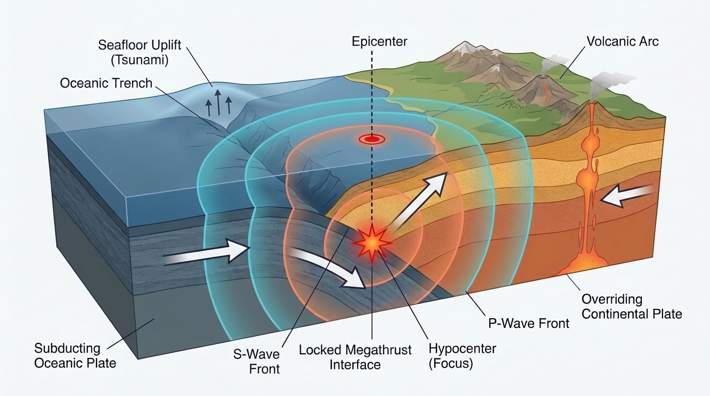
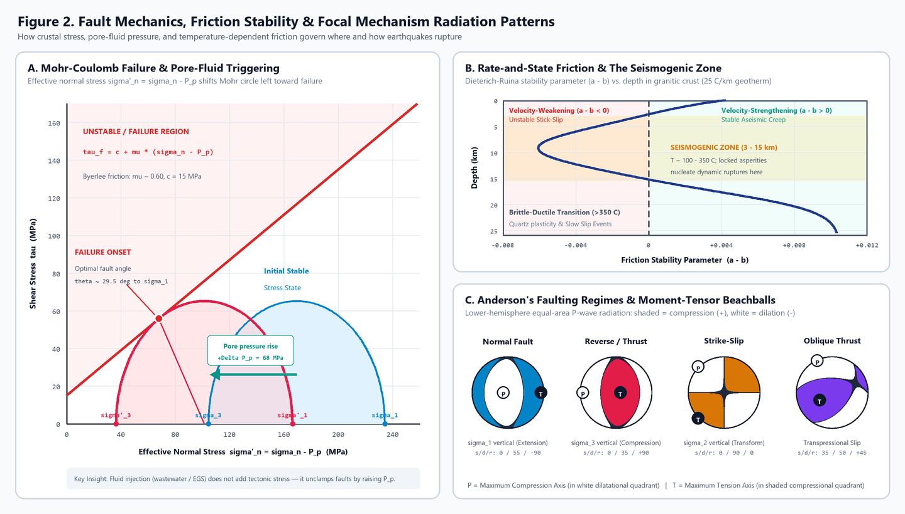
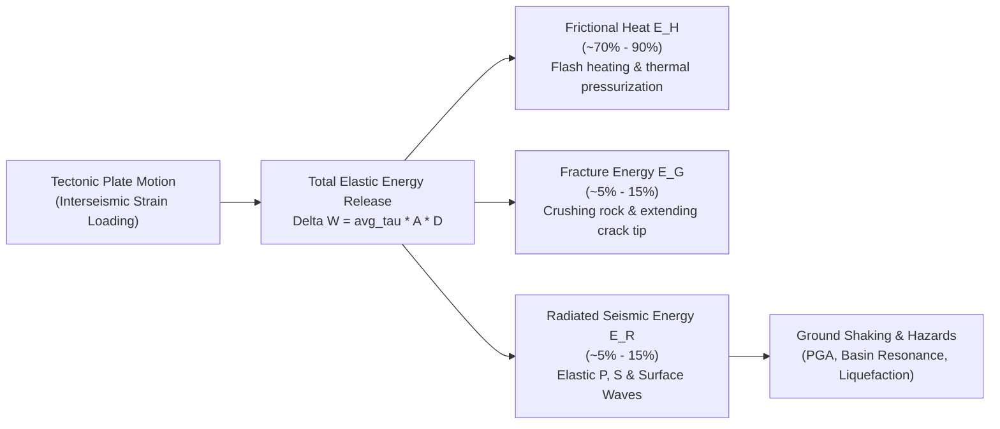
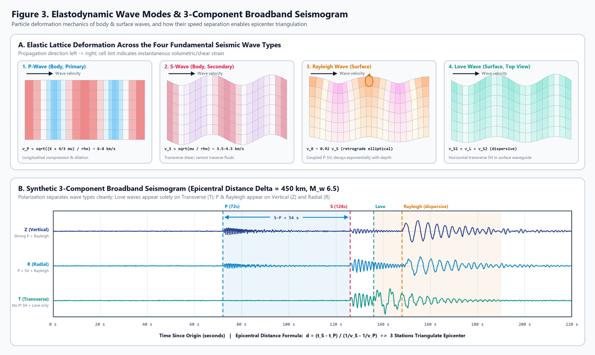
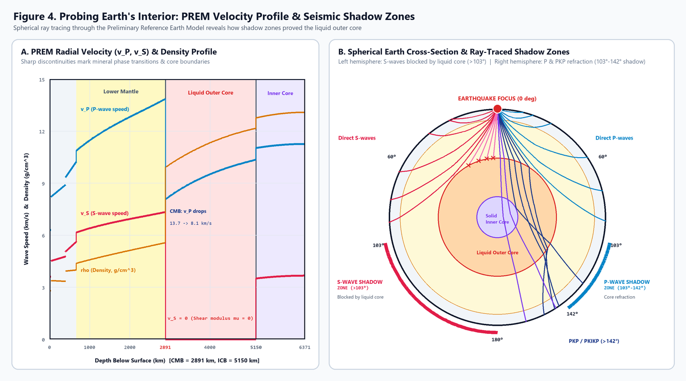
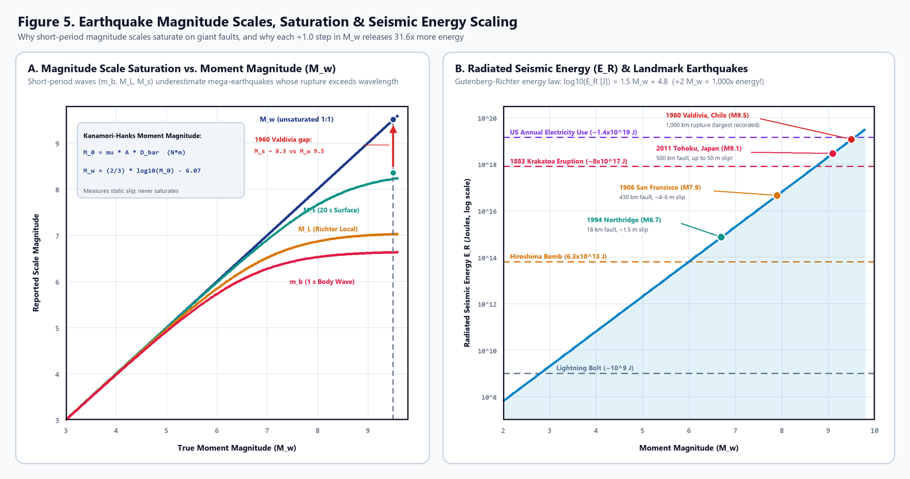
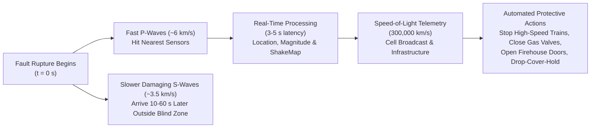
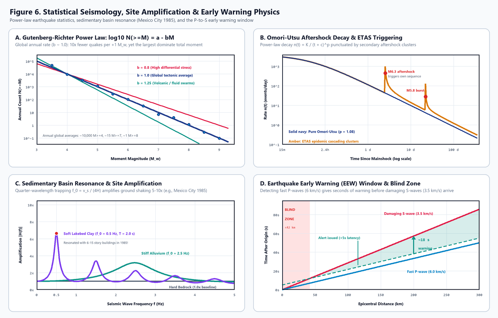

# The Science of Earthquakes: From Atomic Friction to Planetary Tomography

An earthquake is not merely "the ground shaking." Physically, it is a **dynamic shear-fracture instability** inside a stressed elastic solid—the abrupt conversion of decades or centuries of slowly accumulated tectonic elastic strain energy into rock fracture, frictional heat, permanent crustal deformation, and elastic waves that ring the entire planet like a bell.

Because seismic waves traverse Earth's interior at kilometers per second, earthquakes simultaneously represent one of nature's most formidable hazards and humanity's sharpest "ultrasound scanner" for imaging the inaccessible depths of our planet.

---

## 1. The Tectonic Engine & Elastic Rebound Theory

Earth's rigid outer shell—the **lithosphere** ($\sim 100\text{ km}$ thick)—is fractured into roughly a dozen major tectonic plates gliding over the ductile asthenosphere at $1\text{–}10\text{ cm/yr}$ (comparable to fingernail growth), driven primarily by **slab pull** (dense, cold oceanic lithosphere sinking into the mantle at subduction zones) and **ridge push**.

Where plates meet, friction locks the shallow brittle interface while the deeper mantle continues to move steadily. Following the catastrophic 1906 San Francisco earthquake, geophysicist **Harry Fielding Reid** analyzed decades of geodetic triangulation surveys across the San Andreas Fault and formulated **Elastic Rebound Theory** (1910):

1. **Interseismic Loading:** Far-field plate motion steadily bends crustal rock on either side of a locked fault, storing elastic shear strain energy $U = \frac{1}{2}\int_V \sigma_{ij}\varepsilon_{ij}\,dV$.
2. **Coseismic Rupture:** When shear stress on the fault overcomes static friction, the fault unlocks and slips violently over seconds to minutes. The bent crust snaps back ("rebounds") toward an unstrained configuration, radiating seismic waves.
3. **Postseismic Relaxation:** Viscoelastic mantle flow, aseismic afterslip, and pore-fluid redistribution relax residual stress concentrations over months to decades—driving aftershocks and reloading adjacent fault segments.

### Plate Boundary Settings & Seismicity

| Boundary Type | Tectonic Stress Regime | Typical Max $M_w$ | Depth Range | Iconic Examples |
| :--- | :--- | :---: | :---: | :--- |
| **Convergent (Subduction Megathrust)** | Compression ($\sigma_3$ vertical) | $9.0\text{–}9.5$ | $0\text{–}700\text{ km}$ (Wadati-Benioff zone) | 1960 Valdivia ($M_w 9.5$), 2004 Sumatra ($M_w 9.2$), 2011 Tōhoku ($M_w 9.1$) |
| **Convergent (Continental Collision)** | Compression (thrust/fold belts) | $7.8\text{–}8.6$ | $0\text{–}40\text{ km}$ | 2008 Wenchuan ($M_w 7.9$), 2015 Gorkha/Nepal ($M_w 7.8$) |
| **Transform (Strike-Slip)** | Horizontal shear ($\sigma_2$ vertical) | $7.8\text{–}8.3$ | $0\text{–}20\text{ km}$ | 1906 San Francisco ($M_w 7.9$), 2023 Kahramanmaraş ($M_w 7.8$) |
| **Divergent (Mid-Ocean Ridges / Rifts)** | Extension ($\sigma_1$ vertical) | $6.0\text{–}7.2$ | $0\text{–}15\text{ km}$ | East African Rift, Mid-Atlantic Ridge, Iceland |
| **Intraplate (Reactivated Ancient Rifts)** | Far-field ridge-push stress | $7.0\text{–}7.7$ | $5\text{–}25\text{ km}$ | 1811–1812 New Madrid ($M_w \sim 7.5$), 2001 Bhuj, India ($M_w 7.7$) |

> [!NOTE]
> **Why Megathrusts Produce the Planet's Largest Earthquakes:** Subduction interfaces dip shallowly ($10^\circ\text{–}25^\circ$) into cold oceanic lithosphere, allowing the brittle seismogenic zone to span $150\text{–}250\text{ km}$ in down-dip width and over $1{,}000\text{ km}$ along strike—giving rupture areas $A$ roughly $20\text{–}50\times$ larger than vertical strike-slip faults like the San Andreas.

---

## 2. Rock Mechanics, Fault Friction & Focal Mechanisms

Why does a fault stay locked for 300 years and then slip 30 meters in 90 seconds? And why do crustal earthquakes occur mostly between $3\text{ km}$ and $15\text{ km}$ depth rather than everywhere? The answer lives in **Coulomb failure**, **rate-and-state friction**, and **moment-tensor mechanics**.

### 2.1 Mohr-Coulomb Failure & Pore-Fluid Unclamping

Slip initiates on a fault plane when the resolved shear traction $\tau$ reaches the **Mohr-Coulomb failure criterion**:

$$\tau_f = c + \mu (\sigma_n - P_p) = c + \mu \sigma'_n$$

where $c$ is rock cohesion, $\mu$ is the coefficient of static friction ($\mu \approx 0.6\text{–}0.85$ for most dry rocks—**Byerlee's Law**), $\sigma_n$ is the lithostatic normal stress clamping the fault shut, and $P_p$ is the **pore-fluid pressure** inside microscopic cracks and fault gouge.

Crucially, pore fluid pushes outward against the normal stress, reducing the **effective normal stress** $\sigma'_n = \sigma_n - P_p$. On a Mohr circle diagram (**Figure 2A**), raising $P_p$ shifts the entire stress circle horizontally to the left without changing the differential stress $(\sigma_1 - \sigma_3)$—driving a previously stable fault straight across the failure envelope. This exact mechanism explains **induced seismicity** from deep wastewater disposal wells (e.g., Oklahoma, 2009–2016) and Enhanced Geothermal Systems (EGS).

### 2.2 Rate-and-State Friction & The Seismogenic Zone

Classical Amontons-Coulomb friction (a constant $\mu$) cannot explain why some faults creep quietly without earthquakes while others stick and snap violently. Laboratory rock-friction experiments by **James Dieterich** and **Andy Ruina** established the **Rate-and-State Friction (RSF)** law:

$$\mu(V, \theta) = \mu_0 + a \ln\!\left(\frac{V}{V_0}\right) + b \ln\!\left(\frac{V_0 \theta}{D_c}\right), \qquad \frac{d\theta}{dt} = 1 - \frac{V\theta}{D_c}$$

Here $V$ is slip velocity, $\theta$ is a state variable representing the average lifetime of microscopic grain contacts (asperities) that weld and strengthen over time, $D_c$ is the critical slip distance needed to renew contacts, and $a, b$ are dimensionless material parameters:

- **Direct effect ($a > 0$):** Jumping to a higher slip speed instantaneously raises friction by $a \ln(V/V_0)$.
- **Evolution effect ($b > 0$):** As the fault slips over distance $D_c$, old welded contacts break and friction drops by $b \ln(V/V_0)$.

At steady state ($\theta_{ss} = D_c / V$), friction scales with velocity as $\mu_{ss}(V) = \mu_0 + (a - b)\ln(V/V_0)$. The sign of **$(a - b)$** controls earthquake physics (**Figure 2B**):

- **Velocity-Strengthening ($a - b > 0$):** Faster slip creates *more* friction, damping acceleration. The fault slips smoothly via **aseismic creep** (found in shallow clay-rich gouge $<3\text{ km}$ and hot ductile rock $>15\text{ km}$, $T > 350^\circ\text{C}$).
- **Velocity-Weakening ($a - b < 0$):** Faster slip *reduces* friction, creating runaway positive feedback! This unstable regime defines the **seismogenic zone** ($3\text{–}15\text{ km}$ in continental granite, $100^\circ\text{C}\text{–}350^\circ\text{C}$), where earthquakes nucleate.

### 2.3 Anderson's Faulting Theory & Moment-Tensor "Beachballs"

Near Earth's free surface (which supports zero shear traction), one of the three principal stresses ($\sigma_1 > \sigma_2 > \sigma_3$) must be vertical, yielding **Anderson's three fault regimes**. Seismologists invert the first-motion polarities (up = compression, down = dilation) recorded globally to recover the symmetric $3 \times 3$ **Seismic Moment Tensor** $M_{ij}$:

$$M_{ij} = M_0 (n_i d_j + n_j d_i)$$

where $\hat{\mathbf{n}}$ is the fault normal and $\hat{\mathbf{d}}$ is the slip direction. Projecting the P-wave radiation amplitude $R^P(\hat{\mathbf{r}}) = \hat{r}_i M_{ij} \hat{r}_j$ onto a lower-hemisphere stereonet yields the iconic **"beachball" focal mechanism** (**Figure 2C**), whose symmetry exposes both the fault orientation and the regional tectonic compression ($P$) and tension ($T$) axes.

---

## 3. Dynamic Rupture Physics & The Seismic Energy Budget

Once an instability nucleates on a patch of critical radius $L_c \sim \frac{\mu D_c}{(b - a)\sigma'_n}$, a rupture front tears across the fault plane typically at **$70\%\text{–}85\%$ of the local shear-wave speed** ($v_r \approx 2.5\text{–}3.2\text{ km/s}$, **sub-Rayleigh rupture**). Under high prestress on long, straight strike-slip faults (e.g., 2001 Kunlun $M_w 7.8$, 2002 Denali $M_w 7.9$, 2018 Palu $M_w 7.5$), ruptures can jump the forbidden speed gap between the Rayleigh speed $v_R$ and $v_S$ to propagate **supershear** ($v_S < v_r < \sqrt{2}v_S$), generating a devastating **shear-wave Mach cone** analogous to a supersonic sonic boom.

### Where Does All the Elastic Strain Energy Go?

During slip $\bar{D}$ across area $A$, the total gravitational/elastic potential energy drop is $\Delta W = \bar{\tau} A \bar{D}$, where $\bar{\tau} = \frac{1}{2}(\tau_0 + \tau_1)$ is the average shear stress on the fault. Remarkably, **only a small fraction ($5\%\text{–}20\%$) escapes as shaking!**

- **Frictional Heat ($E_H$):** Dominates the budget. At coseismic slip rates of $\sim 1\text{ m/s}$, microscopic contact junctions experience **flash heating** ($>1000^\circ\text{C}$ within milliseconds) and pore water expands violently (**thermal pressurization**), dynamically collapsing friction from $\mu \approx 0.6$ down to $\mu_{\text{dyn}} \approx 0.1$—lubricating the fault mid-rupture!
- **Fracture Energy ($E_G$):** The mechanical work required to break intact rock ahead of the rupture tip and shatter the fault damage zone.
- **Radiated Seismic Energy ($E_R$):** The leftover surplus energy that actually launches elastic waves into the surrounding Earth. Seismologists define the **radiation efficiency** $\eta_R = E_R / (E_R + E_G)$:
  - *Tsunami earthquakes* (e.g., 1992 Nicaragua) have extraordinarily low $\eta_R < 0.05$—slow, sluggish ruptures in soft trench sediments that produce deceptively mild shaking yet catastrophic tsunamis.
  - *Deep intraplate earthquakes* can have high $\eta_R > 0.5$ and high stress drop $\Delta\sigma \approx 10\text{–}30\text{ MPa}$ (versus typical tectonic $\Delta\sigma \approx 3\text{ MPa}$), producing fierce high-frequency shaking.

---

## 4. Elastodynamics & Seismic Wave Propagation

Outside the fault zone, rock behaves as a linear isotropic elastic continuum governed by the **Navier-Cauchy elastodynamic wave equation**:

$$\rho \frac{\partial^2 \mathbf{u}}{\partial t^2} = (\lambda + 2\mu)\nabla(\nabla \cdot \mathbf{u}) - \mu \nabla \times (\nabla \times \mathbf{u})$$

where $\mathbf{u}(\mathbf{x}, t)$ is ground displacement, $\rho$ is density, and $\lambda, \mu$ are the **Lamé elastic moduli** ($\mu$ is shear rigidity; bulk modulus $K = \lambda + \frac{2}{3}\mu$).

Applying the **Helmholtz decomposition** $\mathbf{u} = \nabla \phi + \nabla \times \boldsymbol{\psi}$ cleanly decouples the equation into two independent **body wave** equations:

1. **P-Waves (Primary / Compressional / Dilatational):** Governed by $\nabla^2 \phi = \frac{1}{v_P^2}\ddot{\phi}$, with speed:
   $$v_P = \sqrt{\frac{\lambda + 2\mu}{\rho}} = \sqrt{\frac{K + \frac{4}{3}\mu}{\rho}} \approx 6.0\text{–}8.0\text{ km/s (crust/upper mantle)}$$
   Particles oscillate **parallel** to propagation via alternating compression and expansion. Because fluids possess finite bulk modulus ($K > 0$), P-waves travel through solids, liquids, and gases alike.

2. **S-Waves (Secondary / Shear / Rotational):** Governed by $\nabla^2 \boldsymbol{\psi} = \frac{1}{v_S^2}\ddot{\boldsymbol{\psi}}$, with speed:
   $$v_S = \sqrt{\frac{\mu}{\rho}} \approx 3.5\text{–}4.5\text{ km/s (crust/upper mantle)}$$
   Particles oscillate **perpendicular** to propagation (decomposed into vertical **SV** and horizontal **SH** polarizations). Because liquids cannot sustain static shear stress ($\mu = 0$), **S-waves vanish completely in fluids**. In typical Poisson solids ($\lambda \approx \mu$), $v_P / v_S \approx \sqrt{3} \approx 1.73$.

### Surface Waves: Why Distant Earthquakes Still Destroy Cities

When body waves interact with Earth's free surface and shallow low-velocity layers, constructive interference traps energy in two guided **surface wave** modes:

- **Rayleigh Waves ($v_R \approx 0.92\,v_S$):** Coupled P–SV waves forcing surface particles into **retrograde elliptical orbits** (moving backward at the top of the ellipse, opposite to ocean waves!), with amplitude decaying exponentially over ~1 wavelength of depth.
- **Love Waves ($v_{S1} < v_L < v_{S2}$):** Purely horizontally polarized SH waves trapped by total internal reflection inside a slower upper crustal layer over faster basement rock.

Both surface waves are **dispersive** in Earth's layered crust: long-period waves sample deeper, faster mantle rock and arrive *before* shorter-period waves traveling in the slow shallow crust. Crucially, while body waves expand spherically ($A \propto 1/r$), surface waves expand cylindrically along Earth's 2D surface ($A \propto 1/\sqrt{r}$), allowing them to retain destructive amplitudes hundreds to thousands of kilometers from the epicenter!

### Reading a 3-Component Seismogram & Triangulating the Epicenter

As **Figure 3B** demonstrates, rotating horizontal seismograms into **Radial (R, pointing away from epicenter)** and **Transverse (T, perpendicular)** components alongside **Vertical (Z)** cleanly separates every wave mode:
- **P-waves** arrive first on **Z** and **R**, and are absent on **T**.
- **S-waves** arrive later; the elapsed interval $\Delta t = t_S - t_P$ yields epicentral distance directly:
  $$d = \frac{t_S - t_P}{\frac{1}{v_S} - \frac{1}{v_P}}$$
  Drawing distance circles from **three or more stations** (or solving nonlinear 3D travel-time residuals via Geiger's method) pins down the latitude, longitude, focal depth, and origin time.
- **Love waves** appear *exclusively* on **T**, followed shortly by huge dispersive **Rayleigh waves** on **Z** and **R**, ending in an exponentially decaying **coda** of scattered crustal waves.

---

## 5. Probing Earth's Interior: PREM & Seismic Shadow Zones

Humanity's deepest borehole (the Kola Superdeep Borehole) penetrated just $12.2\text{ km}$—less than $0.2\%$ of Earth's $6{,}371\text{ km}$ radius. Everything we know about the remaining $99.8\%$ comes from inverting millions of earthquake travel times into radial reference profiles like the **Preliminary Reference Earth Model (PREM)** and 3D **seismic tomography**.

In a spherically symmetric Earth where wave speed increases with depth, **spherical Snell's Law** preserves the ray parameter $p$ along every seismic ray:

$$p = \frac{r \sin i(r)}{v(r)} = \text{constant}$$

Because $v(r)$ increases downward through the mantle, rays bend continuously away from the vertical until $\sin i = 1$ (their deepest turning point $r_t = p \cdot v(r_t)$) and curve back upward to Earth's surface.

### Four Historic Discoveries Written in Seismic Rays

1. **The Mohorovičić Discontinuity ("Moho", ~7–70 km depth):** Andrija Mohorovičić (1909) noticed head waves refracting along a sharp velocity jump ($v_P: 6.5 \to 8.1\text{ km/s}$), marking the boundary between buoyant silica-rich crust and dense peridotite mantle.
2. **Mantle Transition Zone (410 km & 660 km):** Sharp jumps in $v_P, v_S, \rho$ record high-pressure mineral phase transformations of olivine $\to$ wadsleyite/ringwoodite (410 km) $\to$ bridgmanite + ferropericlase (660 km).
3. **The Liquid Outer Core (2,891 km — Gutenberg Discontinuity):** Beno Gutenberg (1914) and Richard Oldham (1906) discovered two global silent bands (**Figure 4B**):
   - **S-Wave Shadow Zone ($103^\circ\text{–}180^\circ$):** Direct S-waves vanish completely beyond $103^\circ$ angular distance because they cannot cross the molten Fe-Ni outer core ($\mu = 0 \implies v_S = 0$).
   - **P-Wave Shadow Zone ($103^\circ\text{–}142^\circ$):** At the Core-Mantle Boundary, $v_P$ plunges from $13.7\text{ km/s}$ to $8.1\text{ km/s}$, refracting core-entering P-waves (**PKP**) steeply inward so they emerge beyond $142^\circ$, leaving a $39^\circ$-wide shadow band!
4. **The Solid Inner Core (5,150 km — Lehmann Discontinuity):** Danish seismologist **Inge Lehmann** (1936) explained faint P-wave arrivals detected *inside* the P-wave shadow zone as rays (**PKIKP**) reflecting and refracting off a dense, crystalline **solid iron-nickel inner core** where $v_S \approx 3.6\text{ km/s}$ reappears!

---

## 6. Quantifying Earthquakes: Moment, Magnitude, Energy & Intensity

### Why the Richter Scale Broke Down on Giant Earthquakes

Charles Richter's 1935 Local Magnitude ($M_L$) measured the peak logarithm of ground displacement recorded on a standard short-period ($0.8\text{ s}$) Wood-Anderson torsion seismometer. Along with body-wave magnitude ($m_b$, $1\text{ s}$ period) and surface-wave magnitude ($M_s$, $20\text{ s}$ period), these empirical amplitude scales suffer from **magnitude saturation** (**Figure 5A**):

> [!IMPORTANT]
> When an earthquake's fault length exceeds the wavelength of the seismic wave being measured (e.g., a $1{,}000\text{ km}$ rupture vs. a $60\text{ km}$ 20-second surface wavelength), energy radiated from different parts of the fault interferes incoherently rather than boosting peak short-period amplitude. Consequently, the historic 1960 Valdivia mega-earthquake registered only $M_s \approx 8.3$—dramatically underestimating its true size by over a factor of $60\times$ in energy!

To solve saturation permanently, **Hiroo Kanamori** and **Thomas Hanks** (1977–1979) grounded earthquake size directly in physical fault mechanics via **Seismic Moment ($M_0$)** and **Moment Magnitude ($M_w$)**:

$$M_0 = \mu \, A \, \bar{D} \quad [\text{N}\cdot\text{m}], \qquad M_w = \frac{2}{3}\log_{10}(M_0) - 6.07$$

Because $M_0$ integrates rigidity $\mu$, rupture area $A$, and average static slip $\bar{D}$ (corresponding to the zero-frequency limit of the seismic spectrum), **$M_w$ never saturates**.

### Logarithmic Scaling & Radiated Energy

Using the Gutenberg-Richter empirical energy relation:

$$\log_{10} E_R \approx 1.5 M_w + 4.8 \quad [\text{Joules}]$$

Each **+1.0 increase** in $M_w$ represents:
- **$10\times$** larger wave amplitude (below saturation)
- **$10^{1.5} \approx 31.6\times$** more radiated seismic energy and seismic moment
- Each **+2.0 increase** = **$1{,}000\times$** more energy!

Thus, the 1960 Valdivia $M_w 9.5$ earthquake released roughly **$30{,}000\times$ more energy** than an $M_w 6.5$ earthquake—comparable to the entire annual electricity consumption of the United States (**Figure 5B**).

### Magnitude vs. Shaking Intensity (Why $M_w$ Alone Doesn't Predict Damage)

- **Magnitude ($M_w$)** is a single number describing total energy released at the source.
- **Intensity** (Modified Mercalli Intensity **MMI**, Peak Ground Acceleration **PGA**, Peak Ground Velocity **PGV**) measures *local shaking severity*, which varies dramatically by:
  1. **Focal Depth:** A shallow $M_w 6.3$ directly beneath a city (e.g., 2011 Christchurch, depth 5 km, PGA $> 2.0g$!) can be far deadlier than a deep $M_w 7.5$ at 150 km depth.
  2. **Rupture Directivity:** Like the acoustic Doppler effect, sites ahead of a propagating rupture front receive compressed, high-amplitude velocity pulses ("forward directivity").
  3. **Local Site Geology:** Soft sediments trap and amplify seismic waves by $5\text{–}10\times$ (**Section 7.3**).

---

## 7. Statistical Seismology, Site Effects, Tsunamis & Early Warning

### 7.1 Universal Power Laws: Gutenberg-Richter & Omori-Utsu

Earthquakes exhibit scale-invariant self-organized criticality captured by two remarkably universal empirical laws (**Figure 6A–B**):

1. **Gutenberg-Richter Frequency-Magnitude Law:**
   $$\log_{10} N(\ge M) = a - bM$$
   Globally, $b \approx 1.0$: for every 1-unit drop in magnitude, there are roughly $10\times$ more earthquakes (globally $\sim 1$ event/yr with $M \ge 8$, $\sim 15$ with $M \ge 7$, $\sim 10{,}000$ with $M \ge 4$). Physical variations in $b$ act as a crustal "stress meter": high differential stress produces lower $b \approx 0.7\text{–}0.8$ (favoring large ruptures), whereas volcanic magma/fluid swarms exhibit high $b \approx 1.2\text{–}1.5$. Because energy scales as $10^{1.5M}$ while frequency drops only as $10^{-1.0M}$, **the rarest, largest earthquakes release $>95\%$ of total tectonic energy**—debunking the myth that small earthquakes "safely bleed off pressure" to prevent a Big One!

2. **Omori-Utsu Aftershock Decay Law & ETAS:**
   $$n(t) = \frac{K}{(t + c)^p} \qquad (p \approx 0.9\text{–}1.2)$$
   Aftershocks decay algebraically (not exponentially!), remaining elevated for years after great earthquakes. Modern operational forecasting uses **ETAS (Epidemic-Type Aftershock Sequence)** branching models—recognizing that *every* earthquake (even an aftershock) can trigger its own Omori-Utsu cascade via **static Coulomb stress transfer** ($\Delta\text{CFF} = \Delta\tau + \mu' \Delta\sigma'_n$) and dynamic wave triggering.

### 7.2 Prediction vs. Forecasting vs. Earthquake Early Warning (EEW)

> [!TIP]
> **Why Short-Term Deterministic Prediction Fails, While Early Warning Succeeds:**
> Fault systems sit near a chaotic, heterogeneous critical threshold. A tiny $M_w 2$ micro-rupture and an $M_w 9$ megathrust *start identically* at the nucleation patch—whether the rupture stalls at 50 meters or runs for 500 kilometers depends on stress heterogeneities along the entire fault that cannot be measured at depth. Therefore, seismology focuses on **Probabilistic Seismic Hazard Analysis (PSHA)** for building codes, **Operational Earthquake Forecasting (OEF)** during aftershock sequences, and **Earthquake Early Warning (EEW)** once rupture has *already begun*.

As shown in **Figure 6D**, systems like Japan's **JMA EEW**, California/West Coast **ShakeAlert**, and Mexico's **SASMEX** exploit the speed gap between fast P-waves ($6.0\text{ km/s}$), slower destructive S-waves ($3.5\text{ km/s}$), and speed-of-light radio alerts. Because initial detection and telemetry require $\sim 4\text{–}5\text{ s}$, a **blind zone** of radius $d_{\text{blind}} \approx 35\text{–}45\text{ km}$ surrounds the epicenter, while cities $100\text{–}300\text{ km}$ away gain $15\text{–}60\text{ s}$ of life-saving warning.

### 7.3 Site Amplification, Basin Resonance & Liquefaction

When upward-propagating shear waves cross from stiff bedrock ($v_s \approx 1{,}500\text{ m/s}$) into a soft sedimentary basin of thickness $H$ and shear velocity $v_s$, conservation of energy flux ($\rho v_s \dot{u}^2$) boosts amplitude, and multiple internal reflections produce **quarter-wavelength standing-wave resonance** at fundamental frequency (**Figure 6C**):

$$f_0 = \frac{v_s}{4H}$$

During the **1985 Michoacán, Mexico earthquake ($M_w 8.0$)**, the epicenter lay $350\text{ km}$ away on the Pacific coast—yet Mexico City suffered catastrophic collapse because it sits atop a $40\text{ m}$-thick ancient drained lakebed of ultra-soft clay ($v_s \approx 80\text{ m/s}$). Its fundamental resonant frequency $f_0 = \frac{80}{4 \times 40} = 0.5\text{ Hz}$ ($T_0 = 2.0\text{ s}$) amplified seismic waves $5\text{–}10\times$ and matched the natural sway period of 6-to-15-story buildings ($T_{\text{building}} \approx 0.1 N_{\text{stories}}$), selectively toppling mid-rise structures while short houses and skyscrapers survived!

In saturated, loosely packed sandy soils, cyclic seismic shear waves also cause sand grains to compact, spiking pore-water pressure until $P_p \to \sigma_n$ ($\sigma'_n \to 0$). The soil abruptly loses all shear strength and behaves as a dense liquid—**soil liquefaction**—tilting intact buildings and floating buried tanks to the surface.

### 7.4 Megathrust Tsunami Generation & Shoaling

When a submarine subduction megathrust ruptures (**Figure 1**), the overriding plate rebounds upward by $2\text{–}10\text{ m}$ over hundreds of kilometers, instantaneously displacing an entire water column from seafloor to surface. Because the resulting wavelength ($\lambda \sim 100\text{–}300\text{ km}$) vastly exceeds ocean depth ($h \sim 4\text{ km}$), tsunamis propagate as **shallow-water gravity waves**:

$$c = \sqrt{g h} \qquad (\approx 200\text{ m/s} \approx 720\text{ km/h at } h = 4{,}000\text{ m})$$

In the open ocean, a catastrophic tsunami may be only $0.5\text{ m}$ tall—imperceptible to ships. As it approaches shallow coastal shelves, wave speed plummets ($h: 4{,}000\text{ m} \to 10\text{ m} \implies c: 720 \to 36\text{ km/h}$), compressing the wavelength and amplifying wave height via **Green's Law** ($A \propto h^{-1/4}$ plus nonlinear run-up) into towering $10\text{–}40\text{ m}$ walls of water.

---

## 8. Frontiers of Modern Seismology

Earthquake science is currently undergoing a revolution driven by dense instrumentation, laboratory physics, and machine learning:

1. **Slow Earthquakes & Episodic Tremor and Slip (ETS):** Discovered via continuous GPS arrays in Cascadia and Japan in the early 2000s, "silent earthquakes" release the equivalent of $M_w 6.5\text{–}7.0$ of fault slip over *weeks to months* instead of seconds right at the brittle-ductile transition ($a - b \approx 0$), radiating faint non-volcanic tremor while periodically loading the locked megathrust directly above them.
2. **Deep-Focus Earthquakes (300–700 km depth):** At pressures above $10\text{ GPa}$, ordinary brittle Coulomb friction should be impossible—rock ought to flow plastically. Yet $M_w 8.3$ earthquakes occur at $>600\text{ km}$ depth (e.g., 2013 Sea of Okhotsk). Leading mechanisms include **transformational faulting** (metastable olivine collapsing abruptly into denser spinel inside cold subducting slabs) and **thermal shear runaway**.
3. **Fiber-Optic Distributed Acoustic Sensing (DAS):** By firing laser pulses down existing dark telecommunication fiber-optic cables (including subsea cables!) and measuring Rayleigh backscattered phase shifts, seismologists convert ordinary fiber lines into tens of thousands of virtual seismic sensors spaced meters apart—bringing offshore megathrust monitoring into real time.
4. **Deep Learning Seismology:** Neural phase pickers (e.g., *PhaseNet*, *EQTransformer*) trained on millions of broadband waveforms now detect $10\times$ more tiny micro-earthquakes than traditional STA/LTA algorithms, illuminating razor-sharp 3D fault architectures, hidden foreshock migrations, and fluid pathways in unprecedented detail.
