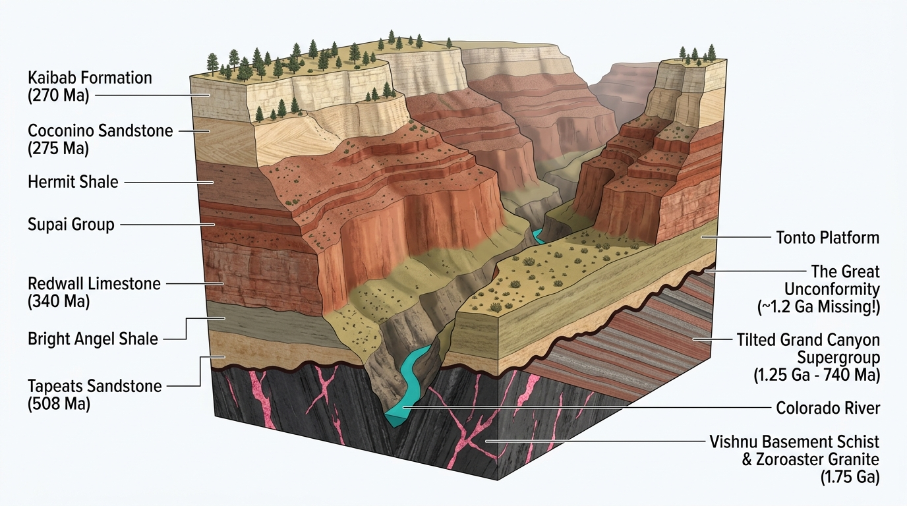
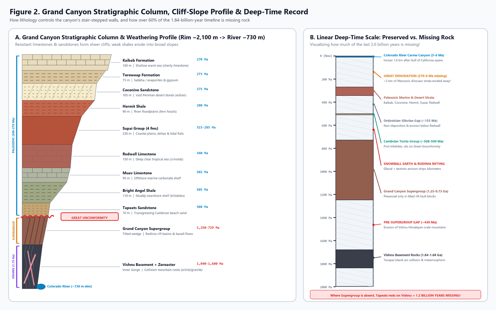
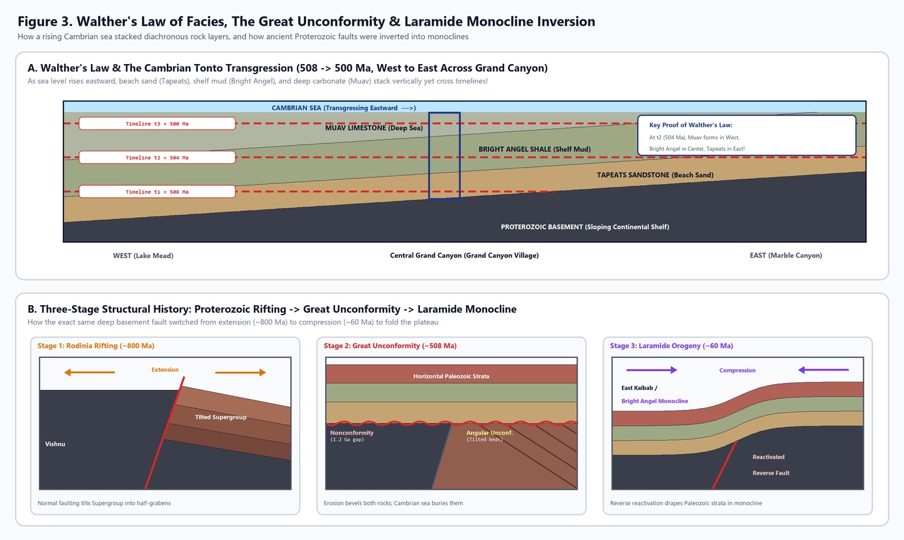
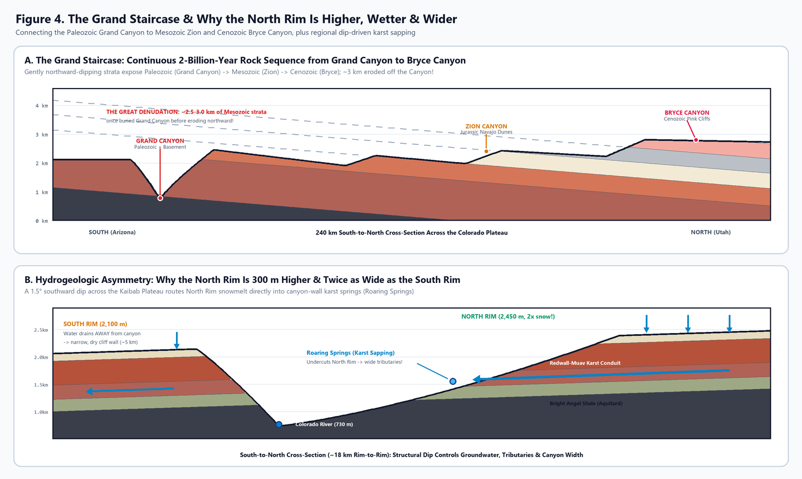
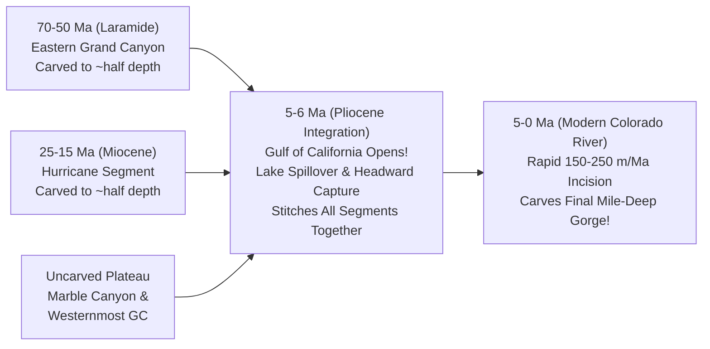
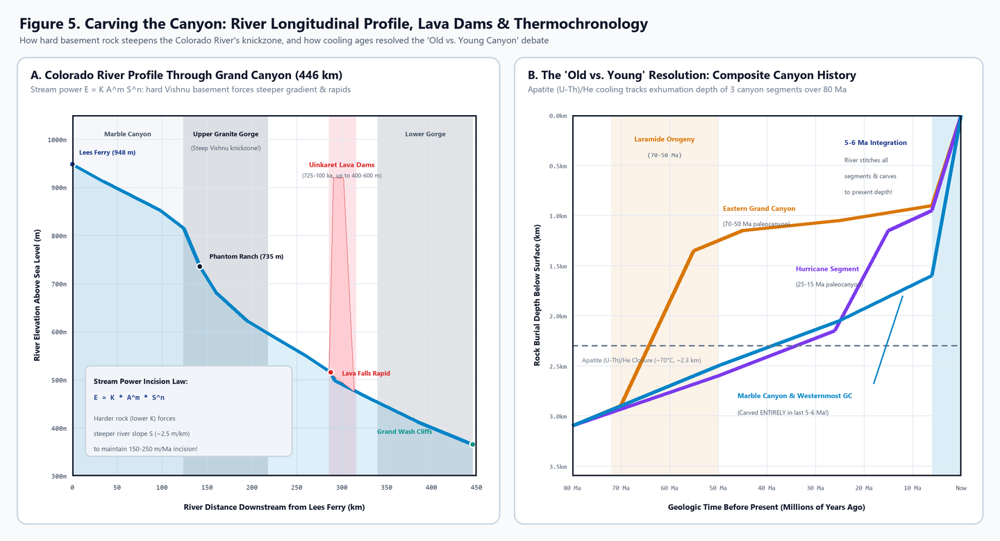
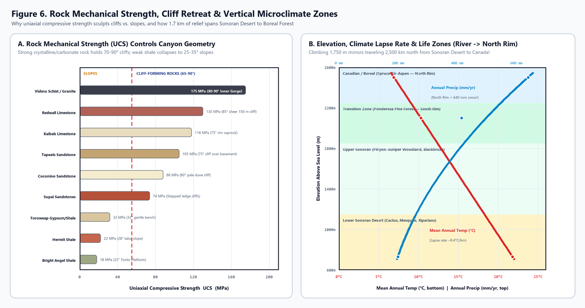

# The Geology of the Grand Canyon: Two Billion Years Written in Stone

Few places on Earth lay open planetary history as clearly as the **Grand Canyon** of northern Arizona. In a single $1.6\text{ km}$ ($1\text{-mile}$) vertical slice across the uplifted **Colorado Plateau**, the Colorado River has exposed nearly **two billion years** of crustal collision, supercontinent rifting, global glaciation, advancing and retreating tropical seas, vast sand-dune deserts, mountain building, volcanic lava dams, and rapid river incision.

What makes the Grand Canyon uniquely illuminating for geology is not merely its depth—it is the **unusually crisp separation of three fundamentally different rock worlds** stacked one atop another, separated by one of the most dramatic time gaps in the geological record: **The Great Unconformity**.

---

## 1. The Three Great Rock Packages & Deep Time

Every rock exposed between the canyon rims ($\sim 2{,}100\text{–}2{,}450\text{ m}$ elevation) and the Colorado River ($\sim 730\text{ m}$ at Phantom Ranch) belongs to one of three distinct architectural sets (**Figure 2A**):

### 1.1 Set I — Vishnu Basement Rocks (Paleoproterozoic, 1.84–1.68 Ga)
Down inside the steep, dark, V-shaped **Inner Gorge**, the rocks are no longer flat sedimentary layers—they are vertically foliated, jet-black **metamorphic schists and gneisses** (Vishnu, Rama, and Brahma Schists) shot through with bright pink veins and plutons of **Zoroaster Granite**.

- **Origin:** Around $1.75\text{ billion years ago}$, volcanic island arcs (the Yavapai and Mojave terranes) collided with the southern edge of ancestral North America (Laurentia). Marine shales and basalts were buried **$20\text{–}25\text{ km}$ deep** beneath a Himalaya-scale mountain range, baked at $500^\circ\text{C}\text{–}700^\circ\text{C}$ and $6\text{ kbar}$ pressure (amphibolite-grade metamorphism), and intruded by granitic magma.
- Over the next **$400\text{ million years}$**, erosion stripped away the entire mountain range down to its crystalline roots—the flat surface exposed along the floor of the Inner Gorge today.

### 1.2 Set II — The Grand Canyon Supergroup (Mesoproterozoic–Neoproterozoic, 1.25 Ga–729 Ma)
Resting atop the eroded Vishnu roots—and preserved *only* in select tilted wedges in eastern Grand Canyon (visible from Desert View and along the river near Unkar Creek)—lies **$3.7\text{ km}$ of tilted ($10^\circ\text{–}15^\circ$) sedimentary and volcanic strata**:
- **Unkar Group (1.25–1.10 Ga):** Bass Limestone (hosting 1.2-billion-year-old fossil **stromatolites**), Hakatai Shale, Shinumo Quartzite, Dox Sandstone, and the dark **Cardenas Basalt** lava flows erupted during continental rifting.
- **Nankoweap, Chuar, and Sixtymile Formations (780–729 Ma):** Shallow marine mudstones preserving microscopic **vase-shaped microfossils** (early eukaryotic testate amoebae) deposited right before the onset of global Cryogenian "Snowball Earth" glaciation.

### 1.3 Set III — Layered Paleozoic Strata (Cambrian–Permian, 508–270 Ma)
Capping the upper two-thirds of the canyon is a **$1{,}200\text{ m}$-thick** layer cake of nearly horizontal sedimentary rocks deposited as ancestral Arizona drifted from near the South Pole across the equator while global sea levels rose and fell across the continent:

| Formation / Group | Age (Ma) | Thickness | Rock Type & Signature Feature | Ancient Environment |
| :--- | :---: | :---: | :--- | :--- |
| **Kaibab Formation** | $270$ | $100\text{ m}$ | Cherty cream limestone (rim caprock) | Warm, shallow tropical sea (brachiopods, sponges) |
| **Toroweap Formation** | $273$ | $75\text{ m}$ | Gypsum, siltstone & thin limestone | Coastal sabkha & evaporating tidal flats |
| **Coconino Sandstone** | $275$ | $105\text{ m}$ | Pale quartz sand with $30^\circ$ cross-beds | Vast Sahara-like Permian desert dunes (*Chelichnus* tracks) |
| **Hermit Shale** | $280$ | $90\text{ m}$ | Brick-red fissile siltstone/mudstone | Broad, arid river floodplains (seed ferns, dragonflies) |
| **Supai Group (4 fms)** | $315\text{–}285$ | $230\text{ m}$ | Stepped rust-red sandstone & mudstone | Oscillating coastal plains, deltas & estuaries |
| **Redwall Limestone** | $340$ | $150\text{ m}$ | Pure blue-gray limestone stained red | Deep, clear tropical sea (crinoids, corals, nautiloids) |
| **Temple Butte Fm.** | $385$ | $0\text{–}120\text{ m}$ | Purple dolomite lenses filling channels | Devonian tidal channels & estuaries |
| **Muav Limestone** | $502$ | $95\text{ m}$ | Mottled gray-green cliff limestone | Offshore marine carbonate shelf |
| **Bright Angel Shale** | $505$ | $110\text{ m}$ | Olive-green fissile shale (Tonto bench) | Nearshore muddy shelf (trilobites, burrows) |
| **Tapeats Sandstone** | $508$ | $70\text{ m}$ | Coarse tan cliff-forming sandstone | Transgressing Cambrian sandy beach |

> [!NOTE]
> **Why Is the "Redwall" Limestone Red?** Freshly broken Redwall Limestone is actually **cool blue-gray**! Its iconic terracotta-red facade is purely a surface paint job: rainwater leaching iron oxides ($\text{Fe}_2\text{O}_3$, hematite) out of the overlying red Supai Group and Hermit Shale has stained the sheer $150\text{ m}$ cliff face from top to bottom.

---

## 2. The Great Unconformity: Over 1.2 Billion Years of Missing History

Look closely at **Figure 2B**: when you plot Grand Canyon's rock record on a **linear timeline** from $2.0\text{ Ga}$ to Present, a staggering truth jumps off the page—**there is far more missing time than preserved rock!**

John Wesley Powell first recognized this colossal gap during his 1869 wooden-boat expedition down the Colorado River. Inside the Grand Canyon, **The Great Unconformity** manifests in **two distinct textbook forms** sitting side by side (**Figure 3B, Stage 2**):
1. **Nonconformity:** Flat Cambrian Tapeats Sandstone ($508\text{ Ma}$) sits directly on top of vertical metamorphic Vishnu Schist ($1{,}750\text{ Ma}$)—a mind-bending **$1.2\text{ billion years}$ of missing rock** where you can literally place one hand on Proterozoic mountain roots and the other on Cambrian beach sand!
2. **Angular Unconformity:** Where Proterozoic rift blocks survived erosion, flat Tapeats Sandstone ($508\text{ Ma}$) slices straight across the tilted $15^\circ$ edges of the Grand Canyon Supergroup ($1{,}250\text{–}729\text{ Ma}$)—removing **$220\text{–}700\text{ million years}$** of rock.

### What Erased Kilometers of Continental Crust?
Modern thermochronology (Keller et al. 2019; Peak et al. 2021) reveals that the Great Unconformity was not a single event, but a **multi-stage continental beveling**:
- **Rodinia Breakup (~800–700 Ma):** Tectonic uplift and normal faulting during the rifting of supercontinent Rodinia exposed kilometer-scale blocks to subaerial erosion.
- **Snowball Earth Glacial Planing (~717–635 Ma):** During the Sturtian and Marinoan Cryogenian glaciations, continental ice sheets likely scoured several kilometers of weathered crust across Laurentia, grinding rock into fine sediment and dumping vast quantities of phosphorus, calcium, and iron into the oceans—potentially fueling the nutrient surge behind the **Cambrian Explosion** of complex animal life!

---

## 3. Walther's Law of Facies & The Cambrian Tonto Transgression

Standing on the Tonto Platform, you see three distinct horizontal formations stacked vertically: **Tapeats Sandstone** (bottom), **Bright Angel Shale** (middle), and **Muav Limestone** (top). An intuitive—but **incorrect**—assumption is that the entire region was first a beach, then suddenly became a muddy bay, and finally became a deep sea.

In 1894, German geologist **Johannes Walther** articulated **Walther's Law of Facies**: *vertical successions of conformable sedimentary facies mirror the lateral environments that existed side-by-side at the same moment in time.*

As global Cambrian sea levels rose steadily from west to east across Arizona between **$508\text{ Ma}$ and $500\text{ Ma}$** (**Figure 3A**):
- High-energy breaking waves deposited coarse **beach sand** (Tapeats) right along the moving shoreline.
- Further offshore in quieter water, fine **silt and clay** settled simultaneously (Bright Angel).
- Still farther west in clear, sediment-free deep ocean water, marine organisms precipitated **carbonate ooze** (Muav).

As the shoreline marched hundreds of kilometers eastward, each environment migrated on top of the previous one. Consequently, **formation boundaries cut diagonally across timelines (they are diachronous!)**—confirmed by trilobite index fossils proving that the Tapeats Sandstone in western Grand Canyon is millions of years *older* than the exact same Tapeats Sandstone in eastern Grand Canyon!

---

## 4. Structural Geology: Laramide Flat-Slab Subduction & Monoclines

Why is the Colorado Plateau elevated **$2.1\text{–}2.5\text{ km}$ above sea level** as a nearly flat, unbroken crustal slab—even though the Rocky Mountains buckled sharply to the east and the Basin and Range Province stretched apart by $100\%$ immediately to the west?

During the **Laramide Orogeny (~70–40 Ma)**, the oceanic **Farallon Plate** subducted beneath western North America at an unusually shallow ("flat-slab") angle, scraping directly along the underside of the continental lithosphere over $1{,}000\text{ km}$ inland. Compressive stresses propagated across the Colorado Plateau and **inverted ancient Proterozoic basement faults** (**Figure 3B, Stage 3**):

- Faults that had originally slipped *downward* under extension during Rodinia rifting (~800 Ma) were forced *upward* in **reverse slip** under Laramide compression!
- Instead of shattering cleanly to the surface, the overlying ductile Paleozoic sedimentary blanket draped smoothly over the rising basement steps—forming spectacular single-limbed folds called **monoclines** (such as the **East Kaibab Monocline**, which uplifts the Kaibab Plateau by nearly $1\text{ km}$, and the **Bright Angel Fault** zone, along which the Bright Angel Trail descends!).

---

## 5. The Grand Staircase & North-vs.-South Rim Asymmetry

### 5.1 Where Did All the Dinosaurs Go? (The Great Denudation)
Walk along the South Rim today and you stand on $270\text{ Ma}$ Permian Kaibab Limestone—meaning **zero dinosaur-age (Mesozoic) rocks remain on the canyon rim!** Yet Mesozoic rocks *did* once bury the Grand Canyon under **$2.5\text{–}3.0\text{ km}$ of Triassic, Jurassic, and Cretaceous strata**—proved by isolated erosional remnants like Red Butte (just south of the canyon) and by driving north into Utah (**Figure 4A**).

Because the Colorado Plateau tilts gently northward into southern Utah, driving $240\text{ km}$ north from the Grand Canyon climbs continuously upward through younger and younger formations—the **Grand Staircase**:
1. **Grand Canyon (Paleozoic & Basement, 1.84 Ga–270 Ma):** Bottom step, topped by the Kaibab Formation.
2. **Vermilion & White Cliffs — Zion National Park (Triassic–Jurassic, 250–180 Ma):** Towering $600\text{ m}$ petrified dunes of the Jurassic **Navajo Sandstone**.
3. **Gray & Pink Cliffs — Bryce Canyon National Park (Cretaceous–Paleogene, 100–40 Ma):** Freshwater lake limestones of the Claron Formation sculpted into delicate hoodoos.

Together, Grand Canyon, Zion, and Bryce form a **single continuous 2-billion-year stack of Earth history**—where the youngest rock at Grand Canyon is the oldest rock at Zion, and the youngest rock at Zion lies beneath Bryce!

### 5.2 Why the North Rim Is Higher, Wetter & Twice as Wide
Stand at Grand Canyon Village on the South Rim ($2{,}100\text{ m}$) and gaze $16\text{ km}$ across to the North Rim ($2{,}450\text{ m}$). Notice two curious asymmetries: the **Colorado River hugs the South Rim** (only $5\text{ km}$ away horizontally, versus $12\text{ km}$ from the North Rim!), and the **North Rim is deeply carved by vast branching amphitheaters** (Bright Angel Canyon, Clear Creek, Shinumo Creek) while the South Rim is a relatively straight wall.

The culprit is a gentle **$1.5^\circ$ southward structural tilt** across the uplifted Kaibab Plateau (**Figure 4B**):
- Rain and heavy winter snow ($640\text{ mm/yr}$) falling on the high North Rim percolate downward through fractured Kaibab and Supai beds until hitting the impermeable **Bright Angel Shale** aquitard.
- Trapped inside the cavernous **Redwall-Muav karst limestone aquifer**, groundwater flows **down-dip southward directly out of the North Rim canyon wall** as roaring perennial springs (**Roaring Springs**, Tapeats Spring, Vasey's Paradise)—undercutting cliffs (**spring sapping**) and powering energetic tributaries that drive rapid northward cliff retreat!
- Conversely, rain falling on the South Rim drains **southward *away* from the canyon**, starving South Rim cliffs of erosive water!

---

## 6. Carving the Canyon: River Incision, Lava Dams & The "Old vs. Young" Debate

The Grand Canyon's rocks are ancient ($270\text{ Ma}\text{–}1.84\text{ Ga}$), yet **the canyon itself is astonishingly young!** How did the Colorado River saw through $1.6\text{ km}$ of solid rock, and *when* did it happen?

### 6.1 Stream Power Incision & Bedrock Rapids
Bedrock river incision follows the **Stream Power Incision Law**:

$$E = K \, A^m \, S^n$$

where $E$ is vertical downcutting rate ($\sim 150\text{–}250\text{ m/Ma}$ in Grand Canyon!), $A$ is upstream drainage area (a proxy for river discharge), $S$ is channel slope, and $K$ is rock erodibility.

As the Colorado River flows $446\text{ km}$ from Lees Ferry ($948\text{ m}$) to Grand Wash Cliffs ($365\text{ m}$, **Figure 5A**), its slope adjusts dynamically to rock hardness:
- Through the ultra-hard metamorphic **Vishnu Basement** of the Upper Granite Gorge (low $K$), the river steepens dramatically into a convex **knickzone** ($S \approx 2.5\text{ m/km}$) to maintain constant vertical incision!
- Virtually every famous whitewater rapid (Crystal, Lava Falls, Hance) sits where steep side-canyon **flash-flood debris flows** dump house-sized boulders into the main channel, creating localized hydraulic drops that the river slowly grinds down.

### 6.2 Quaternary Lava Dams (Uinkaret Volcanic Field, 725–100 ka)
In western Grand Canyon near River Mile 179 (**Lava Falls**), basaltic volcanoes erupted right along the North Rim during the Pleistocene, sending rivers of molten lava cascading $900\text{ m}$ down into the Colorado River! At least **13 major lava dams**—some towering **$400\text{–}600\text{ m}$ high**—impounded massive lakes backing up past Lees Ferry before catastrophic overtopping and outburst floods tore them apart, leaving black basalt columns clinging high on the canyon walls today.

### 6.3 Resolving the "Old vs. Young Canyon" Controversy
For over a century, geologists argued fiercely: did the Grand Canyon form in the last **5–6 million years** (supported by the **Muddy Creek Constraint**: 6 Ma lake limestones at the canyon mouth contain *zero* Colorado River gravel, proving the river didn't exit there until after $5.3\text{ Ma}$ when the Gulf of California rifted open!), OR was there a **70-million-year-old** Laramide canyon?

Using **Apatite (U-Th)/He thermochronology** (measuring helium trapped inside microscopic apatite crystals once rock cools below $\sim 70^\circ\text{C}$, ~2.3 km depth), **Karl Karlstrom et al. (2014, *Nature Geoscience*)** revealed a brilliant synthesis—the Grand Canyon is a **composite canyon** (**Figure 5B**):

- Two middle segments (**Eastern Grand Canyon** at $70\text{–}50\text{ Ma}$ and the **Hurricane segment** at $25\text{–}15\text{ Ma}$) were partially carved as disconnected paleocanyons millions of years ago.
- Both ends (**Marble Canyon** and **Westernmost Grand Canyon**) remained completely uncarved until **$5\text{–}6\text{ Ma}$**, when lowering of base level in the newly opened Gulf of California triggered cascading **lake spillover** across the plateau—integrating the Colorado River from the Rockies to the sea and slicing the entire canyon down to its present $1.6\text{ km}$ depth!

---

## 7. Rock Strength, Cliff Retreat & Rim-to-River Life Zones

### 7.1 Why Is the Canyon 18 Miles Wide If the River Is 300 Feet Wide?
The Colorado River only cuts **straight down**—like a band saw! What widens the canyon to $16\text{–}29\text{ km}$ ($10\text{–}18\text{ miles}$) is **differential erosion and mass wasting** controlled directly by rock **Uniaxial Compressive Strength (UCS)** (**Figure 6A**):

1. Soft, fissile shales (**Bright Angel Shale**, **Hermit Shale**, UCS $\sim 18\text{–}22\text{ MPa}$) weather rapidly by rainwash and freeze-thaw, retreating into gentle $22^\circ\text{–}30^\circ$ slopes.
2. This undercuts the thick, strong overlying cliff-formers (**Redwall Limestone**, **Coconino Sandstone**, **Kaibab Limestone**, UCS $\sim 88\text{–}130\text{ MPa}$).
3. Vertical tectonic **joints** (fractures) split off huge slabs of undermined cliff rock, triggering rockfalls and talus cones that steadily march the rims outward at roughly **$100\text{–}200\text{ m}$ per million years**—carving isolated erosional monuments ("temples" like Zoroaster Temple and Vishnu Temple) left behind as the rims retreat!

### 7.2 Geology Sculpting Ecology: Mexico to Canada in One Vertical Mile
Because the canyon spans **$1{,}750\text{ m}$ of vertical relief** in an arid interior climate, air temperature drops rapidly with elevation along a steep lapse rate ($\sim 8.4^\circ\text{C/km}$), while orographic lifting triples precipitation from floor to rim (**Figure 6B**):
- **Inner Gorge ($730\text{ m}$, Phantom Ranch):** Mean annual temperature $\sim 22^\circ\text{C}$ (summer highs $> 45^\circ\text{C}$!), $200\text{ mm/yr}$ rain—**Lower Sonoran Desert** (prickly pear, mesquite, bighorn sheep).
- **South Rim ($2{,}100\text{ m}$):** $\sim 10^\circ\text{C}$, $415\text{ mm/yr}$—**Transition Zone** (Ponderosa pine, pinyon-juniper).
- **North Rim ($2{,}450\text{ m}$):** $\sim 7^\circ\text{C}$, $640\text{ mm/yr}$ (over $3.5\text{ m}$ of winter snow!)—**Canadian / Boreal Forest** (Engelmann spruce, subalpine fir, quaking aspen).

Remarkably, the deep canyon even drives **allopatric speciation**: the **Kaibab squirrel** (white tail, dark belly) on the North Rim and the **Abert's squirrel** (gray tail, white belly) on the South Rim evolved separately after the carving of the Grand Canyon stranded Ponderosa pine forests on opposite sides of an impassable desert gorge—a living testament to how plate tectonics and river erosion literally sculpt evolution itself.

