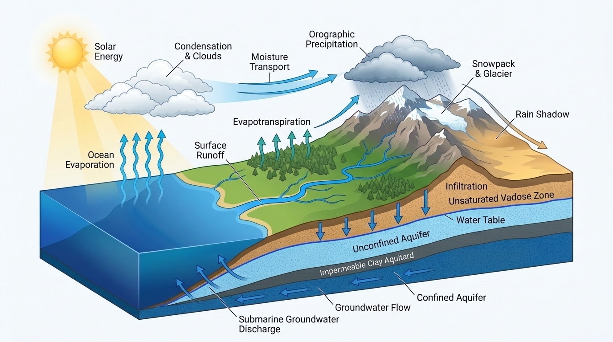
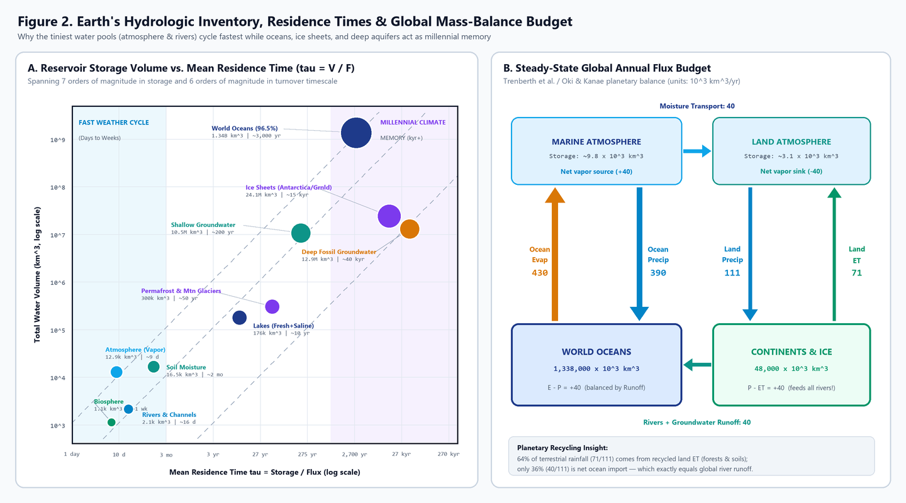
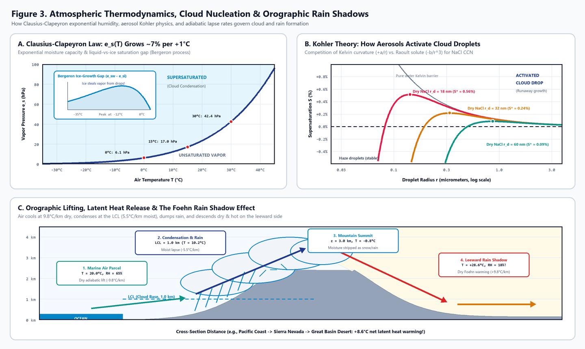
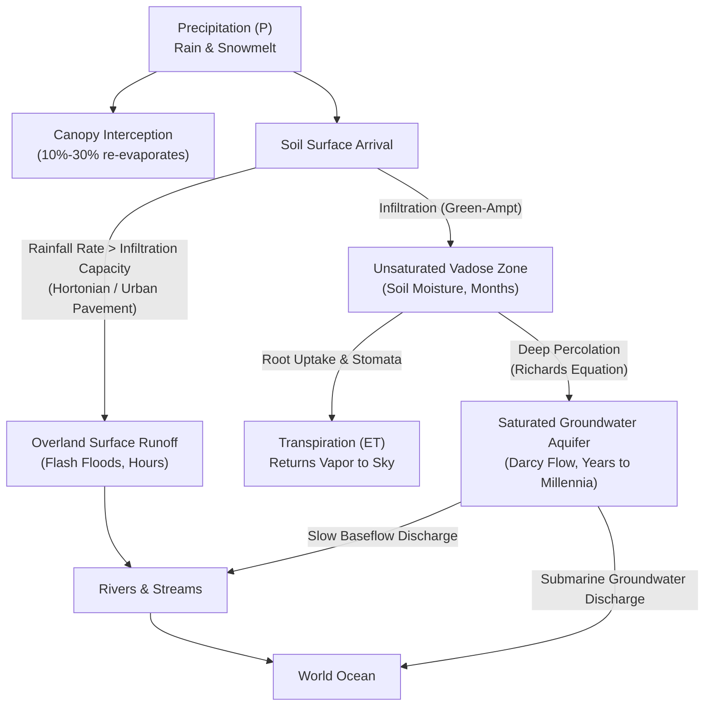
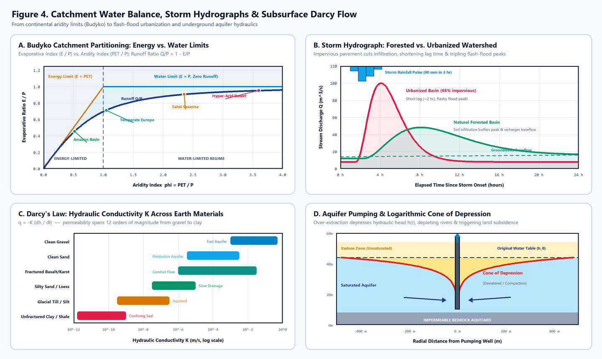
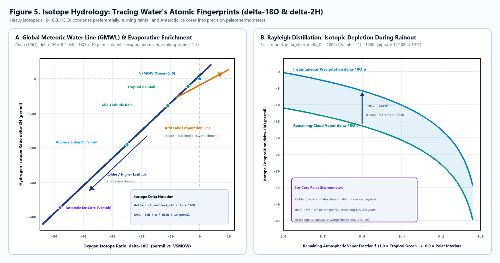
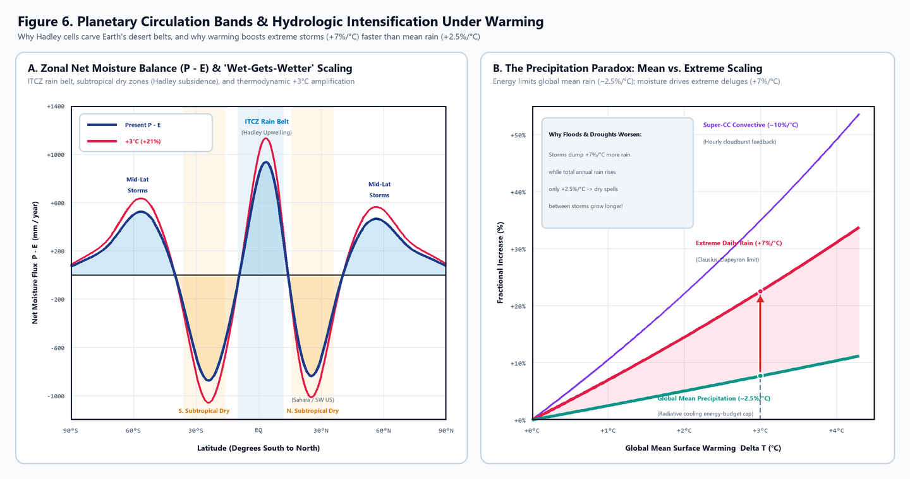

# The Science of the Water Cycle: Earth's Planetary Heat Engine & Hydrologic System

The **water cycle** (or **hydrologic cycle**) is far more than a simple loop of evaporation, clouds, and rain. Physically, it is a **solar- and gravity-powered planetary heat engine** that couples Earth's atmosphere, oceans, cryosphere, biosphere, and lithosphere across 10 orders of magnitude in space and 6 orders of magnitude in time.

Every second, solar radiation evaporates roughly **$16\text{ million metric tons}$** of water across Earth's surface—absorbing nearly **$40\text{ petawatts}$** of latent heat energy ($\sim 80\text{ W/m}^2$ globally averaged, or more than $2{,}000\times$ humanity's entire global power consumption!). When that vapor condenses thousands of kilometers away, it releases that stored solar energy into the atmosphere, powering thunderstorms, monsoons, hurricanes, and poleward heat transport while distilling salty seawater into the freshwater that sustains terrestrial life.

---

## 1. Planetary Inventory, Residence Times & The Global Mass Budget

Earth's hydrosphere holds approximately **$1.386 \times 10^9\text{ km}^3$** of water (enough to cover a smooth spherical Earth to a depth of $2.7\text{ km}$). Yet over **$96.5\%$** is saline ocean water, and of the remaining $2.5\%$ freshwater, nearly **$99\%$** is locked inside polar ice sheets, glaciers, and deep groundwater—leaving less than **$0.01\%$** in all rivers, freshwater lakes, and atmospheric vapor combined!

### Why Small Pools Drive Weather While Giant Pools Drive Climate

The **mean residence time** $\tau = V / F$ (storage volume divided by throughput flux) reveals a striking physical dichotomy (**Figure 2A**):

| Hydrologic Reservoir | Volume ($10^3\text{ km}^3$) | Share of Total | Mean Residence Time ($\tau$) | Dominant Physical Role |
| :--- | :---: | :---: | :---: | :--- |
| **World Oceans** | $1{,}338{,}000$ | $96.54\%$ | $\sim 3{,}000\text{ yr}$ (deep), $\sim 10\text{ yr}$ (mixed layer) | Primary vapor source & thermal flywheel |
| **Ice Sheets & Glaciers** | $24{,}064$ | $1.74\%$ | $50\text{ yr}$ (alpine) to $10{,}000\text{–}100{,}000+\text{ yr}$ (Antarctica) | Albedo regulator, sea-level bank, water towers |
| **Groundwater (Total)** | $23{,}400$ | $1.69\%$ | $100\text{ yr}$ (shallow) to $40{,}000+\text{ yr}$ (deep fossil) | Baseflow buffer & drought reserve |
| **Lakes (Fresh + Saline)** | $176.4$ | $0.013\%$ | $1\text{–}100\text{ yr}$ | Regional storage & thermal moderation |
| **Soil Moisture** | $16.5$ | $0.0012\%$ | $\sim 1\text{–}3\text{ months}$ | Controls plant transpiration & heatwave feedback |
| **Atmosphere (Vapor)** | $12.9$ | $0.0009\%$ | **$\sim 9\text{ days}$** | Rapid planetary distiller & latent-heat conveyor |
| **Rivers & Channels** | $2.12$ | $0.00015\%$ | **$\sim 16\text{ days}$** | Gravity return path & geomorphic sculptor |
| **Biosphere (Living Tissue)** | $1.12$ | $0.00008\%$ | $\sim 7\text{ days}$ | Transpiration conduit & biochemical solvent |

If all water vapor in Earth's atmosphere condensed simultaneously, it would cover the globe in just **$25\text{ mm}$ ($1\text{ inch}$)** of liquid water. Yet global annual precipitation averages **$\sim 990\text{ mm/yr}$**—meaning the entire atmospheric moisture pool is completely flushed and refilled **$\sim 40$ times per year** (roughly once every 9 days!).

### Steady-State Mass Conservation & Terrestrial Moisture Recycling

Across long timescales, planetary water obeys mass conservation (**Figure 2B**, Trenberth et al. / Oki & Kanae budget, in units of $10^3\text{ km}^3/\text{yr}$):

- **Over Oceans:** Evaporation ($430$) exceeds Precipitation ($390$) by **$+40$**, making the oceans a net vapor exporter.
- **Over Land:** Precipitation ($111$) exceeds Evapotranspiration ($71$) by **$+40$**, supplying the exact **$40 \times 10^3\text{ km}^3/\text{yr}$** of river and submarine groundwater runoff returning to the sea.

> [!IMPORTANT]
> **The Recycling Ratio Insight:** Roughly **$64\%$** of global terrestrial rainfall ($71 / 111$) is **recycled continental evapotranspiration**—water transpired by forests, crops, and soils that falls again downwind! In continental interiors like the Amazon Basin or central Eurasia, up to $50\%\text{–}70\%$ of rainfall is recycled via "flying rivers" of vegetation-transpired moisture, making large-scale deforestation a direct throttle on downwind precipitation.

---

## 2. Molecular Thermodynamics: Why Water's Anomalies Build a Habitable Planet

Every macroscopic behavior of the water cycle stems from the quantum geometry of a single $\text{H}_2\text{O}$ molecule: its bent $104.5^\circ$ bond angle and strong oxygen electronegativity create a permanent electric dipole that forms a dynamic 3D **hydrogen-bonding network**. This produces four extraordinary anomalies:

1. **Coexistence Near the Triple Point:** Water's triple point ($273.16\text{ K}, 611.65\text{ Pa}$) sits squarely within Earth's surface temperature range—allowing solid ice, liquid ocean, and gaseous vapor to exchange continuously across the planet.
2. **Colossal Latent Heat:** Breaking hydrogen bonds to evaporate liquid water requires **$L_v \approx 2.50\text{ MJ/kg}$** at $0^\circ\text{C}$ ($2.26\text{ MJ/kg}$ at $100^\circ\text{C}$)—roughly $5\times$ the energy needed to heat water from freezing to boiling! Melting ice absorbs **$L_f = 0.334\text{ MJ/kg}$**.
3. **High Specific Heat Capacity ($c_p = 4{,}184\text{ J/(kg}\cdot\text{K)}$):** Oceans absorb immense solar energy with tiny temperature swings, moderating coastal and global climate.
4. **Density Maximum at $4^\circ\text{C}$ & Floating Ice:** Tetrahedral hydrogen bonding expands ice by $\sim 9\%$ upon freezing ($\rho_{\text{ice}} = 917\text{ kg/m}^3 < \rho_{\text{water}} = 1{,}000\text{ kg/m}^3$). Ice floats and insulates lakes and oceans from above instead of freezing them solid from the bottom up.

### The Clausius-Clapeyron Equation: Exponential Humidity

The equilibrium saturation vapor pressure $e_s(T)$ of water vapor over a flat liquid surface is governed by the **Clausius-Clapeyron relation**:

$$\frac{de_s}{dT} = \frac{L_v \, e_s}{R_v T^2} \quad \Longrightarrow \quad \frac{1}{e_s}\frac{de_s}{dT} \approx 0.068\text{–}0.072\text{ K}^{-1} \quad (\approx +7\% \text{ per } +1^\circ\text{C})$$

where $R_v = 461.5\text{ J/(kg}\cdot\text{K)}$ is the gas constant for water vapor. Because $e_s(T)$ rises exponentially (**Figure 3A**), warm tropical air at $30^\circ\text{C}$ ($e_s = 42.4\text{ hPa}$) can hold **$7\times$ more water vapor** than freezing air at $0^\circ\text{C}$ ($6.1\text{ hPa}$), and over **$20\times$ more** than polar air at $-20^\circ\text{C}$.

---

## 3. Evapotranspiration, Cloud Microphysics & Precipitation

### 3.1 Evapotranspiration & The Penman-Monteith Framework

Over land, water returns to the atmosphere through **evaporation** (bare soil, open water, intercepted canopy rain) and **transpiration** (liquid water drawn by negative xylem water potential from roots up through stems and vaporized through microscopic leaf **stomata**). Transpiration alone accounts for **$\sim 60\%\text{–}65\%$** of all terrestrial evapotranspiration!

Physically, evapotranspiration is controlled by **both** available radiative energy and turbulent vapor transport—unified by the **Penman-Monteith Equation**:

$$\lambda E = \frac{\Delta (R_n - G) + \rho_a c_p \frac{e_s - e_a}{r_a}}{\Delta + \gamma \left(1 + \frac{r_s}{r_a}\right)}$$

where $R_n - G$ is net available radiation, $e_s - e_a$ is the **vapor pressure deficit (VPD)** (atmospheric thirst), $\Delta = de_s/dT$, $\gamma$ is the psychrometric constant, $r_a$ is aerodynamic boundary-layer resistance (wind mixing), and $r_s$ is **canopy stomatal resistance**—meaning living plants actively throttle the water cycle by opening and closing stomata in response to soil drought, VPD, and rising $\text{CO}_2$!

### 3.2 Köhler Theory: Why Clouds Cannot Form in Perfectly Clean Air

If you cool perfectly pure, particle-free air to $100\%$ relative humidity, **no cloud forms!** Why? A tiny spherical embryonic water droplet of radius $r$ experiences enormous surface tension ($\sigma$), raising its equilibrium vapor pressure via the **Kelvin curvature effect**:

$$\frac{e(r)}{e_s(\infty)} = \exp\!\left(\frac{2\sigma}{\rho_w R_v T r}\right) \approx 1 + \frac{a}{r}$$

Homogeneous nucleation in pure air would require **$300\%\text{–}400\%$ relative humidity**—never observed in Earth's troposphere. Instead, clouds require microscopic airborne particles called **Cloud Condensation Nuclei (CCN)** (sea salt, sulfates, dust, organic aerosols). Dissolved salt lowers vapor pressure via **Raoult's Law** ($-b/r^3$). Combining Kelvin curvature and Raoult solute effects produces the **Köhler Equation** (**Figure 3B**):

$$S(r) = \frac{e(r)}{e_s(\infty)} - 1 \approx \frac{a}{r} - \frac{b}{r^3}$$

Below the peak **critical supersaturation ($S^*$)** at critical radius $r^* = \sqrt{3b/a}$, droplets remain tiny stable haze particles. Once rising, cooling air exceeds $S^*$ (typically just **$0.1\%\text{–}0.5\%$** supersaturation!), droplets pass the energy barrier and undergo runaway condensation into visible cloud droplets ($r \sim 10\,\mu\text{m}$).

### 3.3 Turning Cloud Droplets into Raindrops: Warm vs. Cold Microphysics

A cloud droplet ($r \sim 10\,\mu\text{m}$) must grow **$1{,}000{,}000\times$ in volume** to become a falling raindrop ($r \sim 1\text{ mm}$). Diffusion of vapor alone is far too slow (taking hours); two rapid mechanisms bridge the gap:

1. **Warm-Rain Collision-Coalescence** (tropical clouds $> 0^\circ\text{C}$): Slightly larger droplets fall faster than smaller ones, overtaking and merging with them in a runaway sweep-out cascade.
2. **Wegener-Bergeron-Findeisen Process** (mid-latitude & frontal clouds, $-40^\circ\text{C}$ to $0^\circ\text{C}$): Because water molecules bind more tightly in crystalline ice than in liquid water, **saturation vapor pressure over ice is strictly lower than over supercooled liquid water** ($e_{s,i} < e_{s,w}$, peaking at $-12^\circ\text{C}$, **Figure 3A inset**). In a mixed-phase cloud, air saturated with respect to liquid droplets is *strongly supersaturated* with respect to ice crystals! Ice crystals rapidly steal vapor directly from evaporating liquid droplets, grow heavy into snowflakes, fall, and melt into rain below the $0^\circ\text{C}$ isotherm. Most mid-latitude rain actually begins its life as snow!

### 3.4 Adiabatic Lifting & Orographic Rain Shadows

As an air parcel rises, ambient pressure drops, causing it to expand and cool adiabatically at the **Dry Adiabatic Lapse Rate**: $\Gamma_d = g / c_p = 9.8^\circ\text{C/km}$. Once it reaches its **Lifting Condensation Level (LCL)**, water condenses and releases latent heat $L_v$, slowing cooling to the **Moist Adiabatic Lapse Rate** ($\Gamma_m \approx 5.0\text{–}6.0^\circ\text{C/km}$). When moisture-laden winds cross a mountain barrier (**Figure 3C**), precipitation permanently strips water out of the parcel on the windward slope; descending down the leeward side, the now-dry air compresses and warms at the full dry rate ($+9.8^\circ\text{C/km}$), arriving **hotter and far drier** than it started—the **Foehn / Chinook Rain Shadow** responsible for deserts like the Great Basin, Patagonia, and the Gobi.

---

## 4. Land-Surface Hydrology: Partitioning, Floods & Groundwater

When precipitation reaches land, every drop faces a thermodynamic and hydraulic fork in the road—partitioned between evaporation back to the sky, rapid surface runoff, and slow subterranean infiltration:

### 4.1 The Budyko Framework: Energy-Limited vs. Water-Limited Landscapes

At the multi-year catchment scale, long-term water balance ($P = E + Q$) collapses onto the remarkably tight **Budyko Curve** (**Figure 4A**), parameterized by Fu's equation ($\omega \approx 2.6$):

$$\frac{E}{P} = 1 + \phi - \left(1 + \phi^\omega\right)^{1/\omega}, \qquad \phi = \frac{\text{PET}}{P}$$

- **Energy-Limited Catchments ($\phi < 1$, e.g., Amazon, Pacific Northwest):** Rainfall exceeds solar evaporative demand ($\text{PET}$); evaporation approaches $\text{PET}$, and abundant surplus water generates huge rivers.
- **Water-Limited Catchments ($\phi > 1$, e.g., Sahel, American Southwest):** Solar energy exceeds rainfall; virtually all precipitation evaporates ($E/P \to 1$), leaving minimal runoff ($Q/P \to 0$).

### 4.2 Infiltration & Urban Storm Hydrographs

Soil absorbs rain at an infiltration rate governed by gravity and capillary suction (**Green-Ampt / Horton dynamics**), starting high in dry soil and decaying asymptotically toward saturated hydraulic conductivity $K_{\text{sat}}$. When rainfall intensity exceeds $K_{\text{sat}}$ (**Hortonian overland flow**) or when the rising water table hits the surface (**Dunne saturation-excess flow**), rapid surface runoff forms.

Paving a forested watershed with roads, roofs, and storm drains collapses infiltration capacity (**Figure 4B**):
- **Lag time** (storm centroid to flood peak) shrinks by $2\text{–}4\times$.
- **Peak flood discharge** triples, turning gentle rainstorms into lethal urban flash floods.
- **Groundwater recharge** drops sharply, starving dry-season river **baseflow**.

### 4.3 Subsurface Hydraulics: Darcy's Law & Aquifer Depletion

Below the **water table**, water moves slowly through rock pores and fractures obeying **Henry Darcy's Law** (1856):

$$q = -K \frac{dh}{dl}$$

where $q$ is Darcy flux (specific discharge), $dh/dl$ is the hydraulic head gradient, and **$K$ is hydraulic conductivity**, which spans **12 orders of magnitude** across natural Earth materials—from meters per day in clean gravel ($10^{-1}\text{ m/s}$) down to millimeters per century in unfractured clay aquitards ($10^{-11}\text{ m/s}$, **Figure 4C**)!

When high-capacity wells pump groundwater faster than natural recharge, hydraulic head drops logarithmically around the well, carving a **Cone of Depression** (**Figure 4D**). Sustained over-pumping across major agricultural basins (California's Central Valley, the High Plains/Ogallala Aquifer, Northern India, and the North China Plain) reverses hydraulic gradients—pulling river water downward into dry aquifers, drawing saline seawater inland (**saltwater intrusion**), and permanently collapsing dewatered clay interbeds to cause meters of irreversible **land subsidence**.

---

## 5. Isotope Hydrology: Water's Built-In Atomic GPS & Paleothermometer

Not all water molecules weigh the same. Alongside common $\text{H}_2{}^{16}\text{O}$ ($99.73\%$, mass $18\text{ Da}$), natural water contains rare **stable heavy isotopologues**: $\text{H}_2{}^{18}\text{O}$ ($0.20\%$, mass $20\text{ Da}$) and $\text{HD}^{16}\text{O}$ ($0.03\%$, mass $19\text{ Da}$). Hydrologists report isotopic ratios in **delta ($\delta$) permil ($\text{‰}$) notation** relative to Vienna Standard Mean Ocean Water (VSMOW):

$$\delta^{18}\text{O} = \left(\frac{({}^{18}\text{O}/{}^{16}\text{O})_{\text{sample}}}{({}^{18}\text{O}/{}^{16}\text{O})_{\text{VSMOW}}} - 1\right) \times 1000\text{ ‰}$$

Because heavier molecules have lower zero-point vibrational energy and slower thermal speeds, **heavy water evaporates reluctantly and condenses preferentially** ($\alpha = R_{\text{liquid}}/R_{\text{vapor}} > 1$). Two profound consequences follow (**Figure 5**):

1. **The Global Meteoric Water Line (GMWL):** Harmon Craig (1961) discovered that un-evaporated global precipitation falls tightly along a single linear law:
   $$\delta^2\text{H} = 8\,\delta^{18}\text{O} + 10\text{ ‰}$$
   The slope of $8$ reflects the ratio of equilibrium fractionation factors for H vs. O, while the intercept (**deuterium excess**, $d = \delta^2\text{H} - 8\delta^{18}\text{O} \approx +10\text{‰}$) records kinetic non-equilibrium diffusion during ocean evaporation (controlled by sea-surface humidity!). Surface water undergoing open-air evaporation (like an arid desert lake) deviates cleanly to the right along a shallower **Local Evaporation Line (slope $\sim 4\text{–}5$)**, allowing hydrologists to distinguish evaporated lake water from un-evaporated snowmelt or ancient groundwater instantly.

2. **Rayleigh Distillation & Ice-Core Paleoclimate:** As a marine air mass travels poleward or climbs a mountain range and rains out its moisture fraction $f$, heavy isotopes are stripped out first according to **Rayleigh Distillation**:
   $$\delta_v(f) = (\delta_0 + 1000)f^{\alpha - 1} - 1000$$
   Each storm leaves the remaining vapor progressively isotopically lighter—from $\delta^{18}\text{O} \approx -4\text{‰}$ in tropical rain to $-48\text{‰}$ in interior Antarctica! Because colder climates drive greater rainout (smaller $f$), **Antarctic and Greenland ice cores preserve an 800,000-year continuous thermometer** of Earth's Ice Ages written directly in frozen $\delta^{18}\text{O}$ and $\delta^2\text{H}$!

---

## 6. Planetary Circulation Bands & Hydrologic Intensification Under Warming

Earth's global precipitation map is sculpted by planetary-scale atmospheric overturning cells (**Figure 6A**):
- **Intertropical Convergence Zone (ITCZ, $\sim 0^\circ\text{–}10^\circ$):** Intense equatorial solar heating drives deep convective ascent, creating a massive net moisture surplus ($P - E \approx +1{,}000\text{ mm/yr}$) that feeds tropical rainforests.
- **Subtropical Dry Belts ($\sim 20^\circ\text{–}35^\circ\text{ N/S}$):** Descending dry branches of the **Hadley Cells** warm adiabatically, suppressing clouds and carving Earth's great deserts (Sahara, Arabian, Sonoran, Kalahari, Australian Outback) where evaporation exceeds rain ($P - E \approx -900\text{ mm/yr}$).
- **Mid-Latitude Storm Tracks ($\sim 45^\circ\text{–}65^\circ$):** Baroclinic cyclones and narrow, intense moisture corridors called **Atmospheric Rivers** (each transporting as much water vapor as **$15\text{–}25$ Mississippi Rivers**!) deliver abundant rain and snow to temperate continents.

### The Two-Speed Climate Intensification Paradox

How does the water cycle respond as Earth warms? Physics imposes **two completely different scaling rates** (**Figure 6B**):

1. **Extreme Storms & Atmospheric Vapor Scale at $\sim +7\%/^\circ\text{C}$ (Moisture-Limited):** Governed directly by **Clausius-Clapeyron**, individual storms and atmospheric rivers converge all the moisture in a column—making extreme daily deluges intensify at $\sim 7\%/^\circ\text{C}$ (and short-duration hourly convective cloudbursts up to **$10\%\text{–}14\%/^\circ\text{C}$**, "super-CC scaling," as extra latent heat invigorates storm updrafts!).
2. **Global Mean Precipitation Scales Only at $\sim +2\%\text{–}3\%/^\circ\text{C}$ (Energy-Limited):** Globally averaged latent heat release ($L_v P$) must be balanced by **tropospheric radiative cooling to space**. Because greenhouse gases slightly inhibit radiative cooling, total annual global rainfall cannot grow as fast as atmospheric water-holding capacity!

> [!WARNING]
> **Why Warming Simultaneously Intensifies BOTH Floods and Droughts:**
> Because atmospheric water vapor grows at $+7\%/^\circ\text{C}$ while global mean precipitation grows only at $+2.5\%/^\circ\text{C}$, the atmospheric moisture residence time increases ($\tau = V/F$ lengthens!). Storms wait slightly longer to trigger—**lengthening dry spells and intensifying flash droughts** via higher VPD—and then unload significantly heavier downpours when they do break! Meanwhile, **Held-Soden thermodynamic scaling** ($\Delta(P-E) \approx +7\%/^\circ\text{C} \times (P-E)$) amplifies existing wet/dry contrasts ("Wet Gets Wetter, Dry Gets Drier" over oceans and many continental margins), even as warming shifts mountain precipitation from snow to rain—shrinking natural snowpack water towers that billions of people rely on for dry-season irrigation.

---

## 7. Frontiers of Modern Hydrologic Science

1. **Satellite Gravimetry (GRACE / GRACE-FO):** By measuring nanometer-scale changes in the distance between twin orbiting satellites caused by shifting mass below, NASA's GRACE missions literally **weigh underground aquifers, melting ice sheets, and soil moisture from space**—revealing hidden groundwater depletion worldwide in real time.
2. **Surface Water and Ocean Topography (SWOT):** Launched in late 2022, SWOT uses Ka-band radar interferometry to map the elevation and discharge of nearly every river wider than $100\text{ m}$ and millions of lakes across Earth for the first time in history.
3. **Ecohydrologic "Two-Water-Worlds" Hypothesis:** Isotope tracking has revealed that trees and streams often draw from *separate* soil water pools—tightly bound micropore soil water feeding plant transpiration while mobile macropore water bypasses roots directly into groundwater and streams, challenging classical well-mixed soil models.
4. **AI-Driven Global Flood & Streamflow Forecasting:** Deep-learning hydrologic models (LSTMs and graph neural networks trained on global catchment data + satellite precipitation) now outperform traditional physics-only rainfall-runoff models in ungauged basins, extending reliable flood warnings across developing nations by up to 5–7 days.
