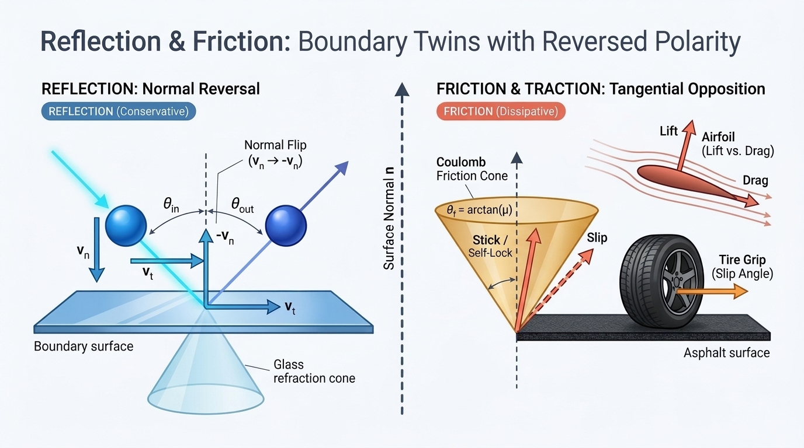
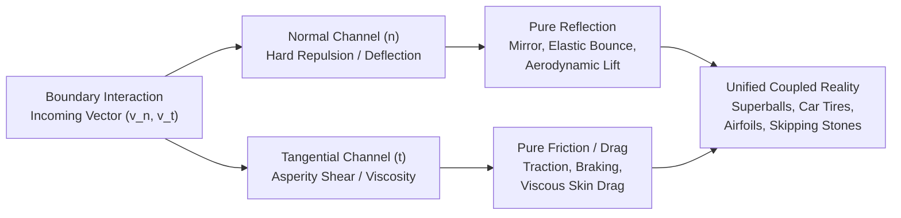
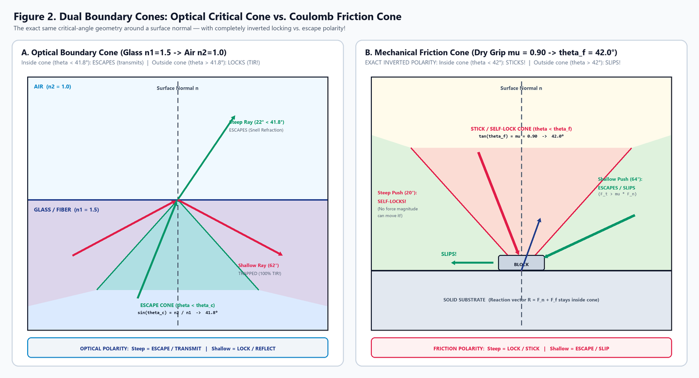
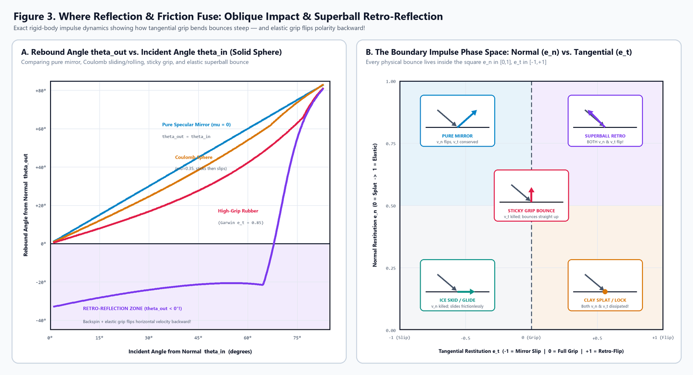
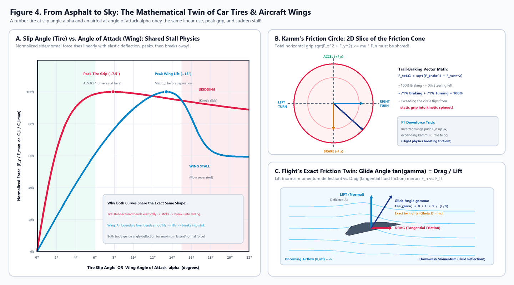
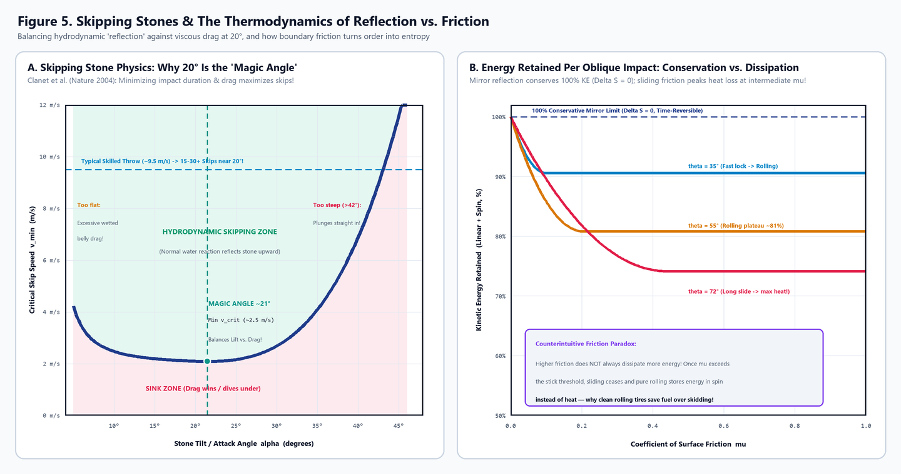
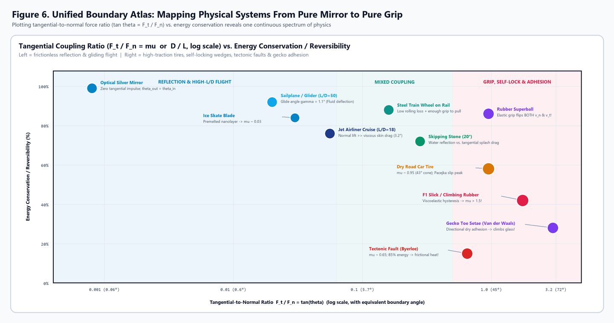

# Reflection & Friction: Boundary Twins with Reversed Polarity

At first glance, **reflection** (a laser bouncing off a mirror, or a billiard ball rebounding cleanly off a rail) and **friction** (a rubber tire gripping asphalt, a self-locking wedge, or air dragging across an airplane wing) seem to live in completely different chapters of physics.

Yet look closely at the geometry of any interaction at a **boundary plane** (defined by its surface normal $\hat{\mathbf{n}}$ and tangent $\hat{\mathbf{t}}$), and a remarkable structural symmetry emerges: **Reflection and Friction are orthogonal twins—two halves of the exact same boundary impulse operator, operating on opposite vector components with inverted angle polarity.**

---

## 1. The Boundary Decomposition: Normal Flip vs. Tangential Opposition

Whenever a ray, elastic body, or fluid stream meets a surface, its velocity $\mathbf{v}$ and reaction impulse $\mathbf{J}$ decompose uniquely into a **normal component** (perpendicular to the surface, $\hat{\mathbf{n}}$) and a **tangential component** (parallel to the surface, $\hat{\mathbf{t}}$):

$$\mathbf{v} = v_n \hat{\mathbf{n}} + v_t \hat{\mathbf{t}}, \qquad \mathbf{J} = J_n \hat{\mathbf{n}} + J_t \hat{\mathbf{t}}$$

Now compare the two pure ideals side by side:

| Property | Pure Reflection (Specular Mirror) | Pure Friction / Grip (Coulomb Traction) |
| :--- | :--- | :--- |
| **Active Channel** | **Normal** ($J_n = -2mv_n$, $J_t = 0$) | **Tangential** ($|J_t| \le \mu J_n$, opposes slip $\hat{\mathbf{v}}_t$) |
| **Velocity Action** | $v_n \to -v_n$, $v_t \to +v_t$ | $v_t \to 0$ (stick) or $v_t \to -e_t v_t$ (elastic grip!) |
| **Critical Angle Cone** | $\sin\theta_c = n_2 / n_1$, $\tan\theta_B = n_2 / n_1$ | $\tan\theta_f = \mu = F_{t,\max} / F_n$ |
| **Steep Angle ($\theta < \theta_{\text{crit}}$)** | **ESCAPES** (Transmits / Refracts) | **LOCKS** (Sticks / Self-Locks!) |
| **Shallow Angle ($\theta > \theta_{\text{crit}}$)** | **LOCKS** (100% Total Internal Reflection) | **ESCAPES** (Breaks Free / Slides!) |
| **Thermodynamic Arrow** | **Conservative** ($\Delta E = 0$, $\Delta S = 0$, time-reversible) | **Dissipative** ($\Delta E < 0$, $\Delta S > 0$, thermal phonons) |

---

## 2. Workbench 1: The Dual Cones & Inverted Polarity

> [!TIP]
> **Try this live:** Open **Bay 1 (Dual Cones)** in the companion interactive workbench [reflection-friction-workbench.html](reflection-friction-workbench.html) to sweep a single incident angle $\theta$ across both an optical glass interface and a mechanical block simultaneously!

Consider two famous cones centered symmetrically around the surface normal $\hat{\mathbf{n}}$ (**Figure 2**):

1. **The Optical Critical Cone (Snell's Law, $n_1 \to n_2$):**
   Inside glass ($n_1 = 1.50$) facing air ($n_2 = 1.00$), light defines a critical cone of half-angle $\theta_c = \arcsin(n_2/n_1) = 41.8^\circ$ (and Brewster's polarizing angle $\tan\theta_B = n_2/n_1 = 33.7^\circ$).
   - **Inside the cone ($\theta < 41.8^\circ$, steep):** Light **escapes** out of the glass into air.
   - **Outside the cone ($\theta > 41.8^\circ$, shallow/grazing):** Light **locks** inside the glass via $100\%$ **Total Internal Reflection (TIR)**—the exact principle trapping laser pulses inside transoceanic fiber-optic cables.

2. **The Coulomb Friction Cone ($\tan\theta_f = \mu$):**
   Now place a dry block on a surface with friction $\mu = 0.90$, giving the exact same cone half-angle $\theta_f = \arctan(0.90) = 42.0^\circ$! Push on the block at angle $\theta$ from the normal with force $F$:
   $$F_t = F \sin\theta, \qquad F_{f,\max} = \mu F_n = \mu F \cos\theta \implies \text{Stick if } \tan\theta \le \mu \iff \theta \le \theta_f$$
   - **Inside the cone ($\theta < 42.0^\circ$, steep):** The block **SELF-LOCKS!** Because $F$ cancels out completely from both sides of $F\sin\theta \le \mu F\cos\theta$, **you can push with 10 Newtons or 10 million Newtons and it will never move**—every extra Newton of downward force clamps the surface shut proportionally tighter! (This is why doorstop wedges, Morse machine-tool tapers, screw threads, and climbing cams hold colossal loads with zero glue!)
   - **Outside the cone ($\theta > 42.0^\circ$, shallow/grazing):** The block **escapes** into sliding!

Notice the exact **polarity reversal**: swapping optical refraction for mechanical friction keeps the *exact same cone geometry* ($\theta_{\text{crit}} \approx 42^\circ$) while inverting **Lock $\leftrightarrow$ Escape** across the cone wall!

---

## 3. Workbench 2: Oblique Impact & The "Superball" Polarity Flip

What happens when **reflection and friction fuse together in a single millisecond**—like a billiard ball, tennis ball, or rubber superball hitting a rough floor?

For a solid sphere ($I = \frac{2}{5}mR^2$) striking a surface at incident angle $\theta_{\text{in}}$ with normal restitution $e_n$, tangential restitution $e_t$ (elastic shear snap-back of deformed rubber!), and spin $\omega_0$, **Richard Garwin's (1969) exact rigid-body impulse equations** yield:

$$v_n' = -e_n v_n, \qquad J_t = \text{clip}\!\left[\frac{2}{7}m(1 + e_t)(v_t - R\omega_0),\; \pm \mu(1 + e_n)m|v_n|\right], \qquad v_t' = v_t - \frac{J_t}{m}$$

Sweep through the **$(e_n, e_t)$ Boundary Phase Space** (**Figure 3**) and four distinct physical worlds appear at the four corners:

1. **Pure Mirror $(e_n = 1,\, e_t = -1,\, \mu = 0)$:** $v_n$ reverses, $v_t$ is untouched $\implies \theta_{\text{out}} = +\theta_{\text{in}}$.
2. **Coulomb Rolling Sphere $(\mu = 0.35,\, e_t = 0)$:** Friction bites during contact, converting horizontal translation into forward spin until rolling ($v_t' = \frac{5}{7}v_t$) locks in—bending the rebound angle steeper toward the normal.
3. **Sticky Grip Bounce $(e_n = 0.85,\, e_t = 0)$:** Tangential motion vanishes; the ball leaps almost straight upward along $\hat{\mathbf{n}}$.
4. **Superball Retro-Reflection $(e_n \approx 0.94,\, e_t \approx +0.85)$ + Backspin:** When a highly elastic rubber ball grips the floor without slipping, tangential shear strain stores elastic energy like a coiled spring and snaps backward—**reversing BOTH normal velocity ($v_n \to -v_n$) AND tangential velocity ($v_t \to -v_t$)!** As **Figure 3A** proves, $\theta_{\text{out}}$ plunges below $0^\circ$ into the **Retro-Reflection Zone**: the ball bounces straight back toward your hand! (Bounce a Wham-O SuperBall under a table: it hits the floor, reverses spin, hits the underside of the table, reverses *again*, and rockets straight back out to you!)

---

## 4. Workbench 3: From Asphalt to Sky — The Uncanny Twin of Car Tires & Aircraft Wings

You intuited that **car tires** and **flight** belong inside this exact same story—and the mathematical correspondence between them is genuinely breathtaking (**Figure 4**).

### 4.1 Tire Slip Angle $\alpha$ vs. Wing Angle of Attack $\alpha$
Neither a car tire nor an airplane wing obeys naive textbook "rigid block" friction:
- **Car Tire (Pacejka "Magic Formula"):** When you turn a steering wheel, the tire points at a small **slip angle $\alpha$** relative to its actual travel velocity. As rubber tread blocks enter the contact patch, they stick to the asphalt and **twist sideways elastically**, generating a lateral cornering force $F_y(\alpha)$ that rises linearly with $\alpha$, peaks at **$\alpha_{\text{peak}} \approx 6^\circ\text{–}9^\circ$** (where the trailing edge of the contact patch begins slipping), and then collapses into noisy kinetic skidding! *(This is why Anti-Lock Braking Systems [ABS] and Formula 1 drivers constantly pulse right at the ~8–12% slip peak rather than locking the wheels!)*
- **Aircraft Wing (Airfoil Lift Curve $C_L(\alpha)$):** Tilt an airfoil to **angle of attack $\alpha$** into oncoming air. The wing bends airflow smoothly downward (**fluid momentum reflection** $\mathbf{F}_L = -\dot{m}\Delta\mathbf{v}_n$ via circulation), generating normal Lift $C_L(\alpha)$ that rises linearly ($C_L \approx 2\pi\alpha$), peaks near **$\alpha_{\text{stall}} \approx 14^\circ\text{–}16^\circ$**, and then abruptly breaks away as the viscous boundary layer separates—**aerodynamic stall!**

Overlay the two normalized curves (**Figure 4A**) and they are virtually **identical twins**: both rely on smooth elastic/attached deflection of a boundary layer (rubber tread vs. air layer) up to a critical angle where shear stress exceeds grip and breaks into catastrophic separation!

### 4.2 Kamm's Friction Circle & The Glide Angle Twin
- **Kamm's Friction Circle (Figure 4B):** Slice the 3D Coulomb Friction Cone horizontally at load $F_n$, and you get a circle of radius $\mu F_n$:
  $$\sqrt{F_{\text{brake}}^2 + F_{\text{turn}}^2} \le \mu F_n$$
  A driver braking at $100\%$ grip has **zero grip left to steer**; trail-braking at $71\%$ braking leaves $71\%$ cornering ($\sqrt{0.71^2 + 0.71^2} = 1.00$). And how do Formula 1 cars corner at $5g$? **Inverted airplane wings** reflect air *upward* to push normal load $F_n$ down $3\times$—literally using aerodynamic reflection to triple the radius of the mechanical friction cone!
- **Flight's Glide Angle = Friction Angle (Figure 4C):** Decompose total aerodynamic force on an airfoil into **Lift ($L$, normal to airflow)** and **Drag ($D$, tangential fluid friction)**. The steady glide descent angle $\gamma$ obeys:
  $$\tan\gamma = \frac{D}{L} = \frac{1}{L/D} \qquad \Longleftrightarrow \qquad \tan\theta_f = \frac{F_f}{F_n} = \mu$$
  A high-performance sailplane with $L/D = 50$ has an effective "aerodynamic friction coefficient" of just $\mu_{\text{eff}} = 0.02$ ($\gamma = 1.1^\circ$)—flying on the razor edge of pure frictionless reflection!

---

## 5. Workbench 4: Skipping Stones & The Thermodynamics of Friction

### 5.1 Bocquet's $20^\circ$ "Magic Angle"
Skipping a flat stone across a lake is a pure duel between **normal hydrodynamic reflection** (water pushing upward perpendicular to the stone face: $F_n \propto \rho_w A v^2 \sin\alpha$) and **tangential drag** ($F_t \propto \rho_w A v^2 \sin^2\alpha + \text{viscous drag}$) (**Figure 5A**):
- **Too flat ($\alpha < 10^\circ$):** Huge wetted belly area drags across the water, rapidly draining horizontal kinetic energy.
- **Too steep ($\alpha > 42^\circ$):** The stone slices straight underwater instead of reflecting.
- **At $\alpha \approx 20^\circ$** (proven theoretically by Lydéric Bocquet and experimentally by Clanet et al., *Nature* 2004), the critical minimum skipping speed drops to its absolute minimum ($\sim 2.5\text{ m/s}$)—minimizing contact time and splash drag per bounce and enabling world-record throws of $50\text{–}88$ skips!

### 5.2 The Counterintuitive Friction-Energy Paradox & Arrow of Time
Why does pure reflection feel "clean" while friction feels "messy"? At the atomic level, a polished mirror reflects an electromagnetic wave coherently because its surface roughness is far smaller than the wavelength ($\Delta S = 0$, time-reversible). Dry solid friction occurs across microscopic rocky summits (**asperities**) that plastically deform, pluck, and snap—shattering coherent tangential momentum into incoherent **thermal lattice vibrations (phonons)** ($\Delta S > 0$, irreversible!).

Yet **Figure 5B** reveals a wonderful **Friction Paradox** for a bouncing sphere: *increasing surface friction $\mu$ does NOT monotonically increase energy loss!*
- At $\mu = 0$ (mirror), $100\%$ of kinetic energy is conserved.
- At intermediate $\mu$, the sphere slips violently throughout the entire contact interval—maximizing frictional heat!
- At **high $\mu$** (above the stick threshold), the contact point locks quickly into **pure rolling** ($v_c = v_t - R\omega = 0$). Once sliding stops, static friction does **zero work**—storing tangential energy cleanly as rotational spin instead of wasting it as heat! That is why a cleanly rolling bicycle or train wheel with *high* static grip glides effortlessly, while a skidding tire instantly burns energy into smoke.

---

## 6. The Unified Boundary Atlas: One Continuous Spectrum

Plot every physical system we explored on a single unified map—**Tangential-to-Normal Ratio ($\tan\theta = F_t / F_n$)** horizontally versus **Energy Conservation / Reversibility (%)** vertically (**Figure 6**)—and the artificial textbook walls vanish:

- **Top Left (Pure Reflection & Gliding Flight):** Silver optical mirrors ($F_t/F_n \to 0$, $99\%$ conserved), $L/D = 50$ sailplanes ($1.1^\circ$), ice skate blades riding a premelted water nanolayer ($\mu \approx 0.03$), and cruising jetliners ($L/D = 18$, $3.2^\circ$).
- **Center (Mixed Coupling):** Steel train wheels on rails ($\mu \approx 0.16$, rolling efficiently while retaining traction) and $20^\circ$ skipping stones balancing water reflection against splash drag.
- **Right (Traction, Self-Locking & Adhesion):** Rubber superballs (high tangential grip *and* high elasticity $\to$ retro-reflection!), dry road car tires ($\mu \approx 0.95$, $43^\circ$ cone), tectonic earthquake faults (Byerlee friction $\mu \approx 0.65$, converting $\sim 85\%$ of strain energy into frictional heat!), Formula 1 viscoelastic slicks ($\mu > 1.5$), and gecko toe setae using directional Van der Waals forces ($\mu > 3$) to cling upside-down to glass mirrors!

---

## 7. Hands-On Interactive Workbench Guide

Launch **[reflection-friction-workbench.html](reflection-friction-workbench.html)** in your browser to experiment directly with all four workbench bays:

1. **Bay 1 — Dual Cones (TIR vs. Friction):** Hit *"Match $\theta_c = \theta_f$"*, then slowly drag the angle slider across $41.8^\circ$ to watch the optical ray flip from Escape to Lock at the exact angle the mechanical block flips from Self-Lock to Slip! Try *"Test Self-Lock (20°)"* and crank Applied Force to $500\text{ N}$ to prove no force magnitude can overcome a self-locking angle.
2. **Bay 2 — Oblique Bounce & Superball:** Toggle between *"Pure Mirror"*, *"Billiard Cushion"*, *"Superball Retro!"*, and *"Heavy Topspin"* to watch tangential impulse $J_t$ reverse the rebound angle across the surface normal.
3. **Bay 3 — Tire Grip vs. Airfoil Flight:** Sweep the shared angle $\alpha$ from $0^\circ \to 22^\circ$ to watch elastic tread deformation and laminar airflow both build force linearly, hit their respective peaks ($7.5^\circ$ vs. $14.5^\circ$), and then break into skidding and vortex stall! Dial up *Braking %* to watch the resultant grip vector hit the boundary of Kamm's Circle.
4. **Bay 4 — Skipping Stone:** Compare *"Belly-Flop Drag (6°)"*, *"Magic Angle (20°)"*, and *"Steep Plunge (43°)"* to see Bocquet's $20^\circ$ optimum emerge live on the water!
